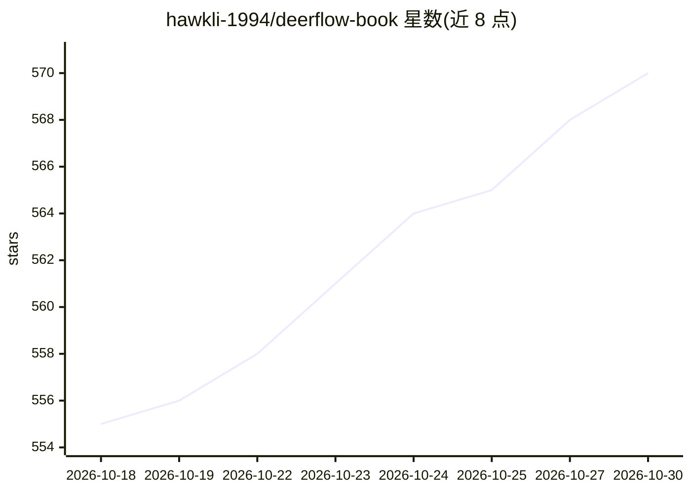

# hawkli-1994/deerflow-book

⭐ 570 · JavaScript · MIT · 推送 2026-10-24 · [GitHub](https://github.com/hawkli-1994/deerflow-book) · [官网](https://hawkli-1994.github.io/deerflow-book) · 个人维护 · 中文 README

**DeerFlow 2.0 框架的中文源码剖析与二次开发技术书**

面向硬核开发者的开源技术书籍，围绕字节跳动开源的 DeerFlow 2.0 super-agent 框架，从理论基础、源码剖析到二次开发实战三部分组织：覆盖 ThreadState 类型系统、14+ 中间件、Skill/Tool 体系、Sub-Agent、Sandbox、Memory（JSON profile/facts，不用向量检索）、MCP Server 集成与企业级案例。所有代码示例基于真实源码，提供 Docker 快速启动流程、按读者角色的阅读路径与前置要求（Python 3.12+、LangChain/LangGraph、Docker），随 DeerFlow 版本迭代持续更新。

## 筛选速览

| 维度 | 判定 | 备注 |
|---|---|---|
| AI 角色 | `ai-knowledge` | 知识聚合/清单类 |
| 许可风险 | `permissive` | MIT |
| 部署形态 | `None` |  |
| 模型依赖 | — | README 未给出锁定关系 |
| 硬件要求 | — | 无带数字的原话,不猜 |
| 安装摩擦 | `low` | 无编译、无系统依赖或容器化 |
| 成熟度 | — | 结构信号不足 |

## 能力要点

- 基于 DeerFlow 2.0 真实源码的章节级解析（附源码文件对照）
- 覆盖 Memory、Sandbox、MCP、Sub-Agent、中间件链等核心子系统
- 提供四类读者的分路径阅读建议与前置要求清单
- 多次基于最新源码的重大更新记录（2026.04/05/06）

## 适用场景

- 系统学习 DeerFlow 源码以进行二次开发
- 为 Agent 框架开发自定义 Skill 与 MCP 集成
- 企业级 Agent 应用（多租户、审批流、知识库）落地参考

## 场景标签

`教程课程` · 领域:学习与行业

## 证据(README 行号)

> L8: > 本书围绕 DeerFlow 2.0，从理论到源码，系统讲解如何进行二次开发。
> L20: - **源码级解析** - 每一章都深入 DeerFlow 源码，不是简单的概念介绍

## 星数曲线

2026-10-18 555 → 2026-10-30 570（+15）

---
*卡片 v1 · prompt 1.4 · 生成 2026-10-21 · 置信度 high · 依据 README sha `c0333083783e` · [字段定义](../../DATASET.md)*
