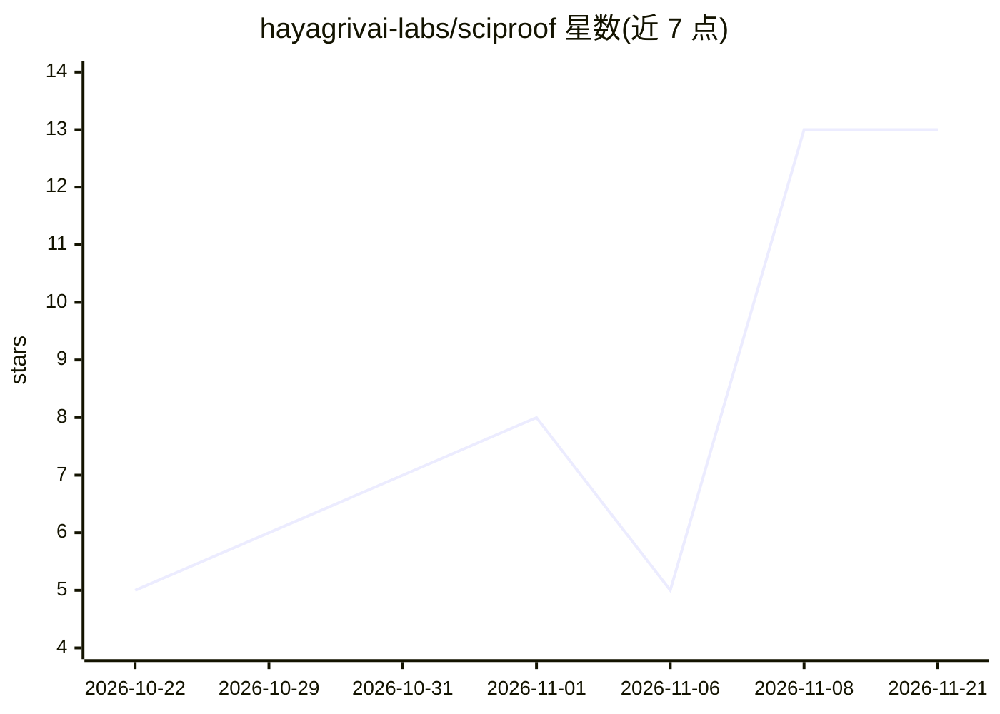

# hayagrivai-labs/sciproof

⭐ 13 · Python · MIT · 推送 2026-11-20 · [GitHub](https://github.com/hayagrivai-labs/sciproof) · [官网](https://hayagrivai-labs.github.io/sciproof/) · 组织维护

**科研计算实验的证据记录与机器可验证工具**

面向计算实验的可复现性 CLI：用 sciproof capture/record 一次性记录命令的输入、输出、环境与数值结果，生成 JSON 证据清单；后续通过 SHA-256 完整性校验、选择性重执行（需 --rerun 显式确认）与声明的 rtol/atol 数值容差进行验证，输出 PASS/FAIL/INCONCLUSIVE 判定及原因。支持 LaTeX 数值导出、OpenSSH 签名、in-toto/OpenLineage 导出、GitHub Action 集成。本地优先、零运行时依赖，不承诺跨硬件位级复现，不判定科学正确性。

## 筛选速览

| 维度 | 判定 | 备注 |
|---|---|---|
| AI 角色 | `ai-ecosystem` | LLM/agent 周边工具 |
| 许可风险 | `permissive` | MIT |
| 部署形态 | `library` | 以包/库形式分发 |
| 模型依赖 | — | README 未给出锁定关系 |
| 硬件要求 | — | 无带数字的原话,不猜 |
| 安装摩擦 | `low` | 无编译、无系统依赖或容器化 |
| 成熟度 | `idea` | |

## 能力要点

- capture/record 生成含 SHA-256、环境与数值快照的证据清单
- opt-in 重执行与 rtol/atol 数值容差验证（支持 json/csv/tsv/npy）
- OpenSSH 签名清单与 --policy TOML 规则校验
- GitHub Action 与 JUnit/Markdown/JSON 报告输出，适配 CI

## 适用场景

- ML 论文投稿前验证实验结果未被改动且可重跑
- 为会议 artifact evaluation 提供一键验证命令
- 科研软件的数值回归测试与基准结果核查
- 从已验证输出导出 LaTeX 数值避免论文数字漂移

## 场景标签

`科研工具` `MLOps` · 领域:学习与行业

## 证据(README 行号)

> L44: supported outputs have not unexpectedly changed. Typical situations: ML experiment verification,
> L45: regression testing for scientific software, numerical simulations, reproducing research results,

## 星数曲线

2026-10-22 5 → 2026-11-21 13（+8）

---
*卡片 v1 · prompt 1.4 · 生成 2026-11-18 · 置信度 mid · 依据 README sha `1f915eab7a45` · [字段定义](../../DATASET.md)*
