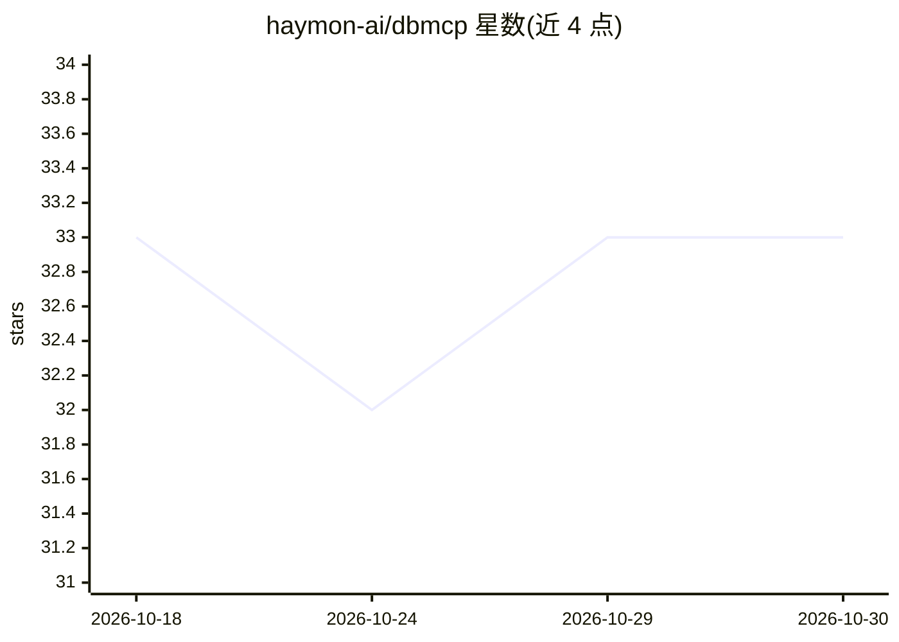

# haymon-ai/dbmcp

⭐ 33 · Rust · MIT · 推送 2026-10-26 · [GitHub](https://github.com/haymon-ai/dbmcp) · [官网](https://dbmcp.haymon.ai) · 组织维护

**把 AI 助手接入 SQL 数据库的 MCP 服务器，含只读与防护**

单二进制 MCP 服务器（约 7 MB，无 Python/Node/Docker 依赖），将 AI 助手连接到 MySQL/MariaDB、PostgreSQL 或 SQLite。提供 schema 发现（listTables/listViews/listTriggers/listFunctions 等）、readQuery/writeQuery 数据访问、DDL 工具与 explainQuery；默认只读模式隐藏写工具。支持 stdio（Claude Desktop、Cursor）与 HTTP 传输，可经内嵌 SSH 隧道访问远程数据库，非回环绑定要求 Bearer token。配置优先级为 CLI 标志 > 环境变量 > 默认值。

## 筛选速览

| 维度 | 判定 | 备注 |
|---|---|---|
| AI 角色 | `ai-ecosystem` | LLM/agent 周边工具 |
| 许可风险 | `permissive` | MIT |
| 部署形态 | `None` |  |
| 模型依赖 | — | README 未给出锁定关系 |
| 硬件要求 | — | 无带数字的原话,不猜 |
| 安装摩擦 | `medium` | 含编译或系统依赖之一 |
| 成熟度 | — | 结构信号不足 |

## 能力要点

- MySQL/MariaDB、PostgreSQL、SQLite 四种后端由一个二进制支持
- 内建只读模式默认屏蔽写查询与 DDL 工具
- 内嵌 SSH 客户端隧道（密钥/密码认证、known_hosts 校验、自动重连）
- stdio 与 HTTP/SSE 双传输，HTTP 支持 Bearer token 与 Origin/Host 白名单

## 适用场景

- 让 Claude Desktop / Cursor 等 MCP 客户端直接查询我的数据库
- 通过 SSH 堡垒机访问内网数据库而不暴露公网
- 以只读模式安全地把生产库结构暴露给 AI 助手

## 场景标签

`数据分析` · 领域:效率与自动化

## 证据(README 行号)

> L8: A single-binary MCP server for SQL databases. Connect your AI assistant to MySQL/MariaDB, PostgreSQL, or SQLite with
> L17: - **MCP tools** — schema discovery (`listDatabases`, `listTables`, `listViews`, `listTriggers`, `listFunctions`, `l
> L19: - **Multiple transports** — stdio (for Claude Desktop, Cursor) and HTTP (for remote/multi-client)

## 星数曲线

2026-10-18 33 → 2026-10-30 33（+0）

---
*卡片 v1 · prompt 1.4 · 生成 2026-10-26 · 置信度 high · 依据 README sha `10fcdd4c6894` · [字段定义](../../DATASET.md)*
