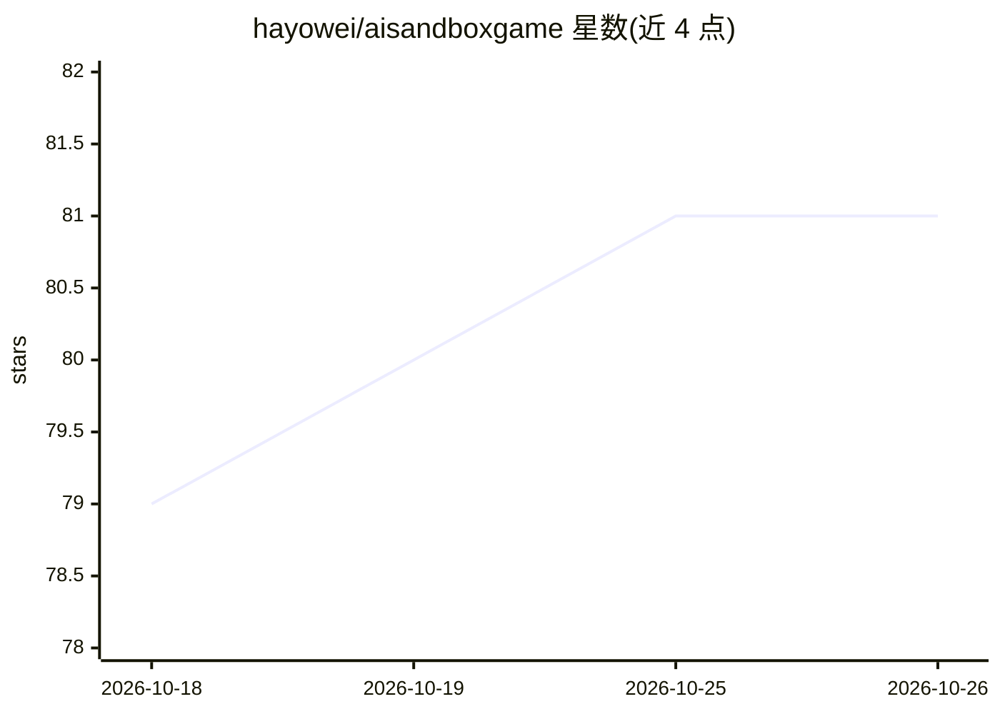

# hayowei/aisandboxgame

⭐ 81 · JavaScript · NOASSERTION · 推送 2026-06-30 · [GitHub](https://github.com/hayowei/aisandboxgame) · [官网](https://aisandboxgame.com) · 个人维护 · 中文 README

**本地优先的浏览器端 LLM 文字 RPG 框架，自带世界卡创作**

纯 HTML/CSS/JS 的浏览器端文字冒险框架：用户自带 LLM API key（OpenAI/Anthropic/DeepSeek/Gemini 等或任意 OpenAI 兼容端点），选择或创作世界卡进行流式叙事游玩。框架提供带认知与关系状态的 NPC、d20 技能检定引擎、持久存档、物品与状态面板、六角地图导航、游戏内手机短信、斜杠命令与主题样式；内置采访式设计模式可从自然语言描述生成完整世界卡。框架代码 AGPL-3.0，prompts 目录资产 CC BY-NC-SA 4.0（非商用）。

## 筛选速览

| 维度 | 判定 | 备注 |
|---|---|---|
| AI 角色 | `ai-native` | 本体是模型或模型工具 |
| 许可风险 | `viral` | NOASSERTION |
| 部署形态 | `None` |  |
| 模型依赖 | — | README 未给出锁定关系 |
| 硬件要求 | — | 无带数字的原话,不猜 |
| 安装摩擦 | `low` | 无编译、无系统依赖或容器化 |
| 成熟度 | — | 结构信号不足 |

## 能力要点

- BYOK 接入 OpenAI/Anthropic/DeepSeek/Gemini 等任意 OpenAI 兼容端点
- 采访式设计模式从自然语言描述生成完整可玩世界卡
- d20 技能检定引擎与带认知/关系状态的 NPC
- 纯静态文件运行，PWA 离线可用，无需构建步骤

## 适用场景

- 用自选 LLM 游玩 AI 驱动的文字冒险 RPG
- 创作自定义题材的世界卡并分享游玩
- 离线（首次加载后）游玩与持久存档管理

## 场景标签

 · 领域:游戏/互动叙事

## 证据(README 行号)

> L5:  A local-first, browser-based text RPG driven by large language models.
> L41: AI Sandbox Game is a browser-based framework for AI-driven text adventures. You bring your own LLM API key, pick or

## 星数曲线

2026-10-18 79 → 2026-10-26 81（+2）

---
*卡片 v1 · prompt 1.4 · 生成 2026-10-24 · 置信度 high · 依据 README sha `1a4104646e2b` · [字段定义](../../DATASET.md)*
