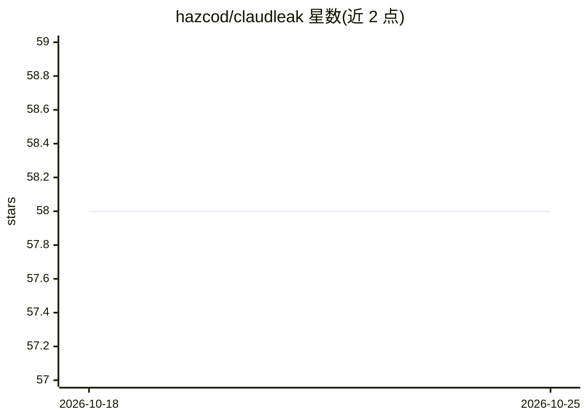

# hazcod/claudleak

⭐ 58 · Go · 推送 2026-05-19 · [GitHub](https://github.com/hazcod/claudleak) · [官网](https://ironpeak.be/blog/leaking-secrets-from-the-claud/) · 个人维护

**扫描公开 GitHub 仓库中 AI 编码工具配置文件泄露凭证的 CLI 工具**

Go 编写的命令行安全扫描工具：通过 GitHub Code Search 发现包含 AI 编码工具配置文件（.claude/、.cursor/、.continue/、.codex/、CLAUDE.md、AGENTS.md 等）的公开仓库，克隆后调用 TruffleHog 检测密钥，将结果限定在 AI 配置路径内，输出表格或 JSON 报告。支持按组织/用户限定扫描范围、并发克隆、仅报告已验证凭证等参数，并以退出码区分结果。面向安全研究人员与开发者。

## 筛选速览

| 维度 | 判定 | 备注 |
|---|---|---|
| AI 角色 | `ai-ecosystem` | LLM/agent 周边工具 |
| 许可风险 | `none` | — |
| 部署形态 | `library` | 以包/库形式分发 |
| 模型依赖 | — | README 未给出锁定关系 |
| 硬件要求 | — | 无带数字的原话,不猜 |
| 安装摩擦 | `low` | 无编译、无系统依赖或容器化 |
| 成熟度 | — | 结构信号不足 |

## 能力要点

- 针对 AI 编码工具配置文件路径过滤的泄露检测
- 基于 GitHub Code Search 的仓库发现与自动克隆扫描
- 复用 TruffleHog 做密钥检测，支持 --verified-only
- 表格/JSON 输出与三种退出码约定，便于 CI 集成

## 适用场景

- 排查本组织公开仓库中 AI 工具配置泄露的凭证
- 批量扫描 GitHub 上含 .claude/.cursor 等配置的仓库
- 以 JSON 输出接入自动化安全审计流程

## 场景标签

`网络安全` · 领域:学习与行业

## 证据(README 行号)

> L3: Scans public GitHub repositories for leaked credentials in AI coding tool configuration files (`.claude/`, `.cursor/
> L62: 3. **Scan** — Runs TruffleHog against each clone, filtering findings to AI config paths

## 星数曲线

2026-10-18 58 → 2026-10-25 58（+0）

---
*卡片 v1 · prompt 1.4 · 生成 2026-10-24 · 置信度 high · 依据 README sha `f58915ca799f` · [字段定义](../../DATASET.md)*
