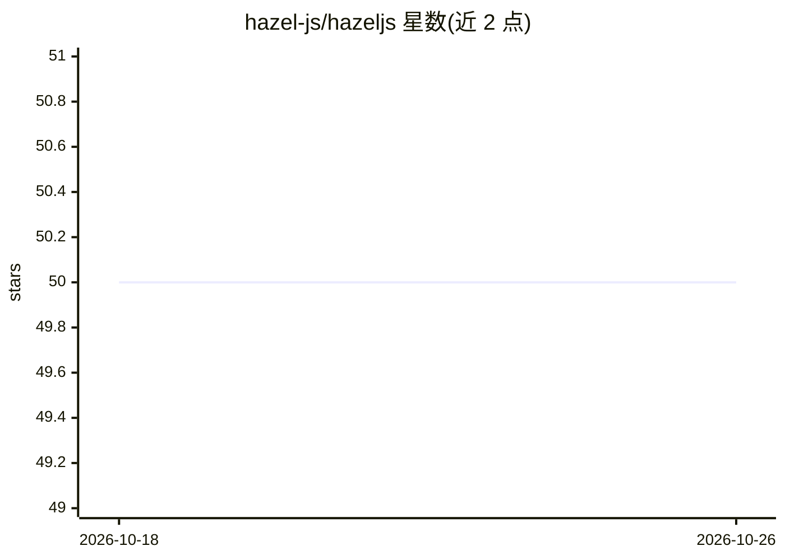

# hazel-js/hazeljs

⭐ 50 · TypeScript · NOASSERTION · 推送 2026-10-25 · [GitHub](https://github.com/hazel-js/hazeljs) · [官网](https://hazeljs.ai) · 组织维护

**TypeScript 后端中运行治理型 Agent 的 Agent OS 框架**

面向 Node.js/TypeScript 后端的 Agent 运行层：以 DNA（版本化身份/提示/技能/策略）、Store 与 hazel apply 声明期望状态；运行时提供 Agent VM（可回滚的推测执行）、封闭集 Decision Runtime（retry/rollback/escalation）、Skillgate（OpenAPI 转受治理技能）、Gatekeeper 默认拒绝的工具授权，以及崩溃安全的人机审批（HITL），运行可在进程重启后存续。本地优先，Kubernetes 可选。提供 CLI 与多个 npm 包，配套 Meridian 教学应用与示例仓库。

## 筛选速览

| 维度 | 判定 | 备注 |
|---|---|---|
| AI 角色 | `ai-ecosystem` | LLM/agent 周边工具 |
| 许可风险 | `permissive` | NOASSERTION |
| 部署形态 | `library` | 以包/库形式分发 |
| 模型依赖 | — | README 未给出锁定关系 |
| 硬件要求 | — | 无带数字的原话,不猜 |
| 安装摩擦 | `low` | 无编译、无系统依赖或容器化 |
| 成熟度 | — | 结构信号不足 |

## 能力要点

- DNA + Store + hazel apply 的声明式本地部署
- Gatekeeper 默认拒绝的失效关闭式工具授权
- Skillgate 将 OpenAPI 规范转为受治理技能
- 崩溃安全的 HITL，运行可跨进程重启存续

## 适用场景

- 在现有 TypeScript 后端中运行带治理的 agent 而非组装多套框架
- 为 agent 的每次工具调用加授权与审计
- 构建需要人工审批环节的持久化 agent 流程

## 场景标签

`Agent 框架` · 领域:Agent 开发

## 证据(README 行号)

> L12: Frameworks help you **build** agents. HazelJS helps you **run** them — durable, governed, local-first.
> L91: |**Define & Deploy**|DNA · Store · Apply|Version identity, prompt, skills, and policy. Declare desired state locall
> L94: |**Govern**|Skillgate · Gatekeeper|Curate which APIs become skills. Authorize every tool call (default deny).|

## 星数曲线

2026-10-18 50 → 2026-10-26 50（+0）

---
*卡片 v1 · prompt 1.4 · 生成 2026-10-25 · 置信度 high · 依据 README sha `bc4bef97dbe7` · [字段定义](../../DATASET.md)*
