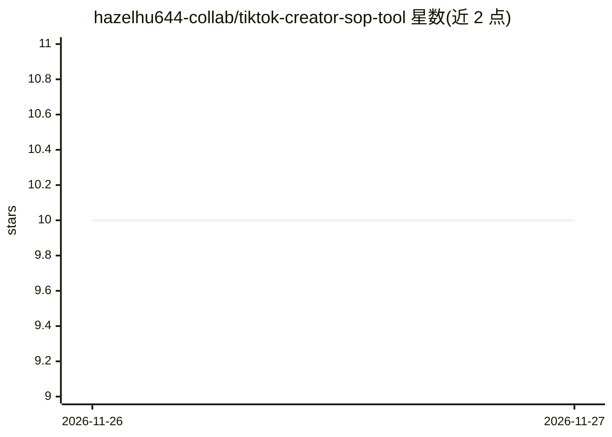

# hazelhu644-collab/tiktok-creator-sop-tool

⭐ 10 · TypeScript · NOASSERTION · 推送 2026-09-14 · [GitHub](https://github.com/hazelhu644-collab/tiktok-creator-sop-tool) · [官网](https://tiktok-creator-sop-tool.vercel.app) · 个人维护 · 中文 README

**给 TikTok Shop 卖家做达人建联与跟进管理的 SOP 工作台**

面向 TikTok Shop 卖家的达人建联与协作管理工作台：上传协作表格后按状态规则生成每日跟进任务清单与优先级排序，管理 14 种达人状态、寄样与视频进度，并按渠道（DM/affiliate/邮件/WhatsApp）与关系层级生成英文触达话术。技术形态为 Vite 静态构建加 Vercel serverless 路由，无数据库无登录，数据留在用户浏览器本地，无需 API key 即可本地生成消息；商业一次性购买，license key 通过 HMAC 签名验证。

## 筛选速览

| 维度 | 判定 | 备注 |
|---|---|---|
| AI 角色 | `ai-native` | 本体是模型或模型工具 |
| 许可风险 | `none` | NOASSERTION |
| 部署形态 | `None` |  |
| 模型依赖 | locked-api |  |
| 硬件要求 | — | 无带数字的原话,不猜 |
| 安装摩擦 | `low` | 无编译、无系统依赖或容器化 |
| 成熟度 | — | 结构信号不足 |

## 能力要点

- 上传表格自动分析达人状态并生成每日跟进任务与优先级
- 多渠道英文触达消息生成，多话术角度轮换避免批量雷同
- license key 无数据库 HMAC 签名验证，数据留在浏览器
- 可选 DeepSeek 集成用于达人回复翻译与个性化回复

## 适用场景

- 管理达人寄样到视频发布的完整跟进流程
- 批量写英文建联与跟进消息时换个说法避免千篇一律
- 判断哪些达人该标记为失败合作候选

## 场景标签

`AI 写作` · 领域:内容生成

## 证据(README 行号)

> L3: An AI-powered workflow platform for TikTok Shop creator outreach and collaboration.
> L19: - AI-assisted creator message generation
> L61: The tool is sold as a one-time purchase and unlocked with a license key. There is

## 星数曲线

2026-11-26 10 → 2026-11-27 10（+0）

---
*卡片 v1 · prompt 1.4 · 生成 2026-11-26 · 置信度 high · 依据 README sha `83b1c2f33266` · [字段定义](../../DATASET.md)*
