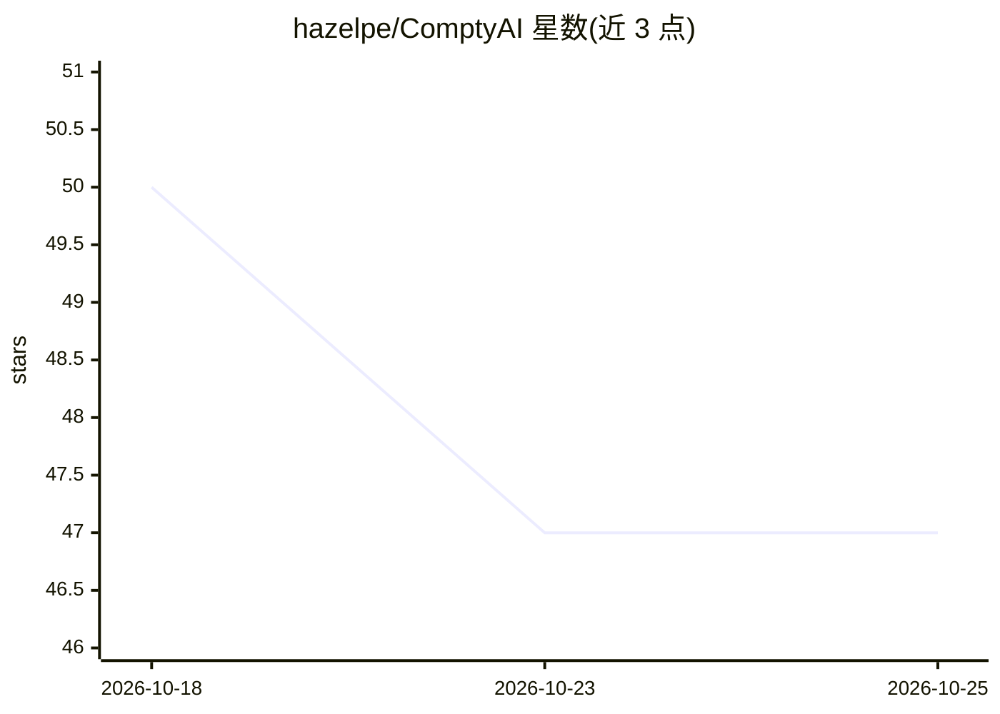

# hazelpe/ComptyAI

⭐ 47 · JavaScript · NOASSERTION · 推送 2026-09-26 · [GitHub](https://github.com/hazelpe/ComptyAI) · [官网](https://www.compty.ai/) · 个人维护

**代币手续费转化为代币持有者 GPU 算力额度的协议原型**

面向 Robinhood Chain（EVM 兼容 Layer 2）设计的算力访问协议参考实现：将协议交易手续费的一部分注入 Compute Treasury，用于 GPU 租赁，符合条件的代币持有者按份额获得 Compute Credits（演示定义为 1 credit = 1 分钟示例 GPU 档位），经算力网关预留、结算与释放额度。仓库当前为协议设计与可本地运行的确定性参考模型，使用 Node.js 22+ 内置模块，无需依赖安装与钱包；链上费用收集、真实 GPU 接入与钱包领取为规划中的集成项，README 声明其不构成已部署或已审计协议。

## 筛选速览

| 维度 | 判定 | 备注 |
|---|---|---|
| AI 角色 | `ai-ecosystem` | LLM/agent 周边工具 |
| 许可风险 | `permissive` | NOASSERTION |
| 部署形态 | `None` |  |
| 模型依赖 | — | README 未给出锁定关系 |
| 硬件要求 | — | 无带数字的原话,不猜 |
| 安装摩擦 | `low` | 无编译、无系统依赖或容器化 |
| 成熟度 | `idea` | |

## 能力要点

- 代币活动→协议费用→算力金库→GPU 租赁→持有者算力额度的五步流程设计
- Compute Credits 含快照分配、预留/结算/释放的使用记账，演示为确定性模拟
- 本地参考模型仅用 Node.js 22+ 内置模块，无需依赖安装与钱包
- 演示定义 1 credit = 1 分钟示例 GPU 档位，含整数预算模型与精确额度分配

## 适用场景

- 研究代币经济与算力资助相结合的协议设计
- 本地运行确定性示例，理解额度分配与结算流程
- 在 Robinhood Chain 测试网上验证网络配置元数据

## 场景标签

 · 领域:区块链/算力基础设施

## 证据(README 行号)

> L19: **ComptyAI turns token activity into access to AI compute.** A portion of collected token-related trading fees or p
> L21: The objective is useful capacity: inference, experiments, agent workloads and, where a supported GPU tier allows it

## 星数曲线

2026-10-18 50 → 2026-10-25 47（-3）

---
*卡片 v1 · prompt 1.4 · 生成 2026-10-25 · 置信度 mid · 依据 README sha `b4323aa53fe6` · [字段定义](../../DATASET.md)*
