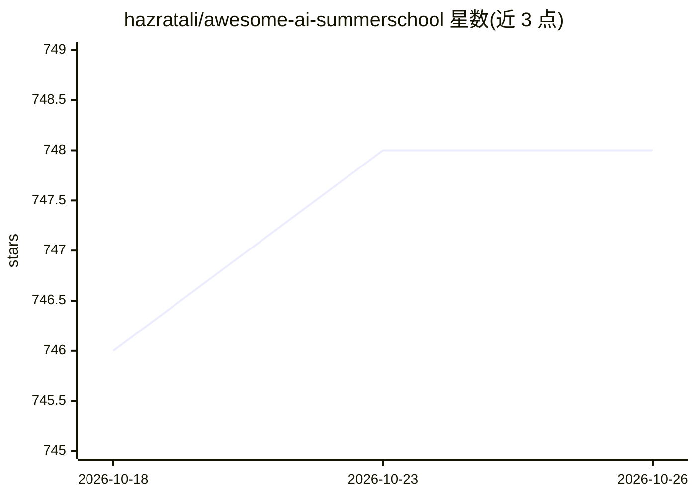

# hazratali/awesome-ai-summerschool

⭐ 748 · 推送 2026-10-20 · [GitHub](https://github.com/hazratali/awesome-ai-summerschool) · 个人维护

**AI/ML/医疗影像领域暑期学校与冬季学校清单**

以表格形式收录人工智能、机器学习、医疗影像与医疗健康领域的暑期学校与冬季学校信息，按年份（2027、2026 等）组织，条目包含名称、地点、日期、申请截止时间、主办方、费用与奖学金情况。覆盖医疗 AI、机器人、材料化学、概率 AI、生成式 AI 等多个方向的学校，读者可通过 fork 仓库提交 PR 补充条目。这是一个纯信息聚合清单，不提供软件安装或运行方式。

## 筛选速览

| 维度 | 判定 | 备注 |
|---|---|---|
| AI 角色 | `ai-knowledge` | 知识聚合/清单类 |
| 许可风险 | `none` | — |
| 部署形态 | `None` |  |
| 模型依赖 | — | README 未给出锁定关系 |
| 硬件要求 | — | 无带数字的原话,不猜 |
| 安装摩擦 | `low` | 无编译、无系统依赖或容器化 |
| 成熟度 | — | 结构信号不足 |

## 能力要点

- 按年份组织的暑期/冬季学校条目表格
- 每条记录含地点、日期、截止时间、主办方、费用与奖学金信息
- 通过 fork 与 PR 接受社区贡献

## 适用场景

- 查找 AI/ML/医疗影像领域近期可报名的暑期学校
- 比较不同学校的费用与奖学金政策
- 为自己的学校提交 PR 收录进清单

## 场景标签

`精选清单` · 领域:学习与行业

## 证据(README 行号)

> L1: # Summer Schools in Artificial Intelligence
> L2: > Various summer schools / winter schools in the field of artificial intelligence, machine learning, medical imaging

## 星数曲线

2026-10-18 746 → 2026-10-26 748（+2）

---
*卡片 v1 · prompt 1.4 · 生成 2026-10-21 · 置信度 high · 依据 README sha `54862abf45ca` · [字段定义](../../DATASET.md)*
