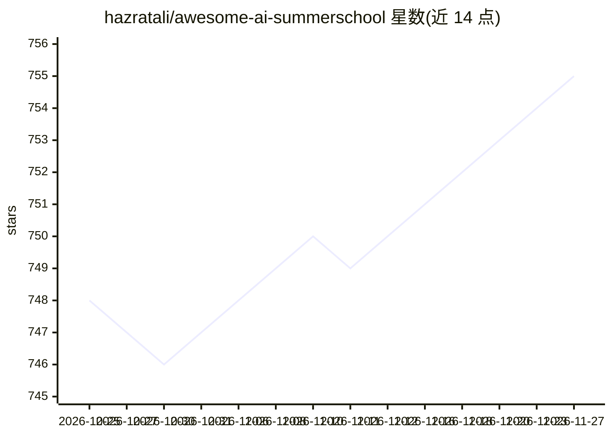

# hazratali/awesome-ai-summerschool

⭐ 755 · 推送 2026-11-20 · [GitHub](https://github.com/hazratali/awesome-ai-summerschool) · 个人维护

**面向 AI/ML 学习者与科研人员的暑期学校/冬季学校信息清单**

以表格形式收录人工智能、机器学习、医学影像与医疗领域的高校与研究机构夏季/冬季学校项目，按年份组织，每条列出名称、地点、日期、报名截止时间、主办方、费用与奖学金信息，覆盖 2026、2027 等年份。通过 fork 仓库并提交 pull request 的方式接受社区补充条目。清单本身不包含课程内容或代码，仅汇总各项目官网之外的基本报名信息。

## 筛选速览

| 维度 | 判定 | 备注 |
|---|---|---|
| AI 角色 | `ai-knowledge` | 知识聚合/清单类 |
| 许可风险 | `none` | — |
| 部署形态 | `None` |  |
| 模型依赖 | — | README 未给出锁定关系 |
| 硬件要求 | — | 无带数字的原话,不猜 |
| 安装摩擦 | `low` | 无编译、无系统依赖或容器化 |
| 成熟度 | — | 结构信号不足 |

## 能力要点

- 按年份组织的 AI/ML/医疗领域暑期与冬季学校清单
- 每条目含地点、日期、截止时间、费用与奖学金信息
- 通过 pull request 接受社区贡献新条目

## 适用场景

- 查找近期开设的 AI/机器学习相关暑期学校并核对报名截止日期
- 对比各学校的费用与奖学金情况
- 了解医疗影像、机器人等细分方向有哪些培训项目

## 场景标签

`精选清单` · 领域:学习与行业

## 证据(README 行号)

> L1: # Summer Schools in Artificial Intelligence
> L2: > Various summer schools / winter schools in the field of artificial intelligence, machine learning, medical imaging
> L12: ## Summer Schools in 2027

## 星数曲线

2026-10-25 748 → 2026-11-27 755（+7）

---
*卡片 v1 · prompt 1.4 · 生成 2026-11-24 · 置信度 high · 依据 README sha `b2f9b190c9af` · [字段定义](../../DATASET.md)*
