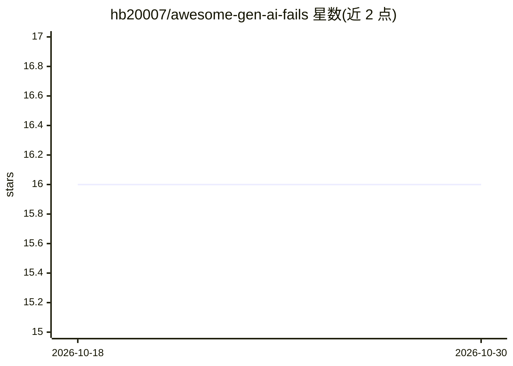

# hb20007/awesome-gen-ai-fails

⭐ 16 · CC0-1.0 · 推送 2026-06-19 · [GitHub](https://github.com/hb20007/awesome-gen-ai-fails) · 个人维护

**生成式 AI 依赖导致危害的事故策展清单**

一份策展型清单（awesome list），按时间倒序收录过度依赖生成式 AI 与 LLM 对企业、个人或社会造成危害的公开事件，分为政府部门、企业与组织（含律师、LLM 提供商）等板块。收录门槛要求至少有一篇知名媒体报道，或可核查的社交媒体来源；接受符合准则的 PR 贡献。条目多为法院对律师引用虚构判例的处罚、AI 幻觉引发的诉讼等案例记录。

## 筛选速览

| 维度 | 判定 | 备注 |
|---|---|---|
| AI 角色 | `ai-knowledge` | 知识聚合/清单类 |
| 许可风险 | `viral` | CC0-1.0 |
| 部署形态 | `None` |  |
| 模型依赖 | — | README 未给出锁定关系 |
| 硬件要求 | — | 无带数字的原话,不猜 |
| 安装摩擦 | `low` | 无编译、无系统依赖或容器化 |
| 成熟度 | — | 结构信号不足 |

## 能力要点

- 按时间倒序组织的事故条目，覆盖政府、律师、LLM 提供商等类别
- 收录门槛：知名媒体报道或可核查的社交媒体来源
- 开放 PR 贡献并设贡献准则

## 适用场景

- 查找 GenAI 幻觉与过度依赖造成危害的历史案例
- 研究 AI 风险与可靠性时获取有据可查的事件素材
- 向团队展示 LLM 局限性的实例引用

## 场景标签

`精选清单` · 领域:学习与行业

## 证据(README 行号)

> L5: This is a list of major incidents caused by overreliance on generative AI, which are often buried amidst the AI hype
> L9: For an incident to be included, it has to be notable. For the purposes of this list, in most cases, there should at 

## 星数曲线

2026-10-18 16 → 2026-10-30 16（+0）

---
*卡片 v1 · prompt 1.4 · 生成 2026-10-30 · 置信度 high · 依据 README sha `33430eb9dd86` · [字段定义](../../DATASET.md)*
