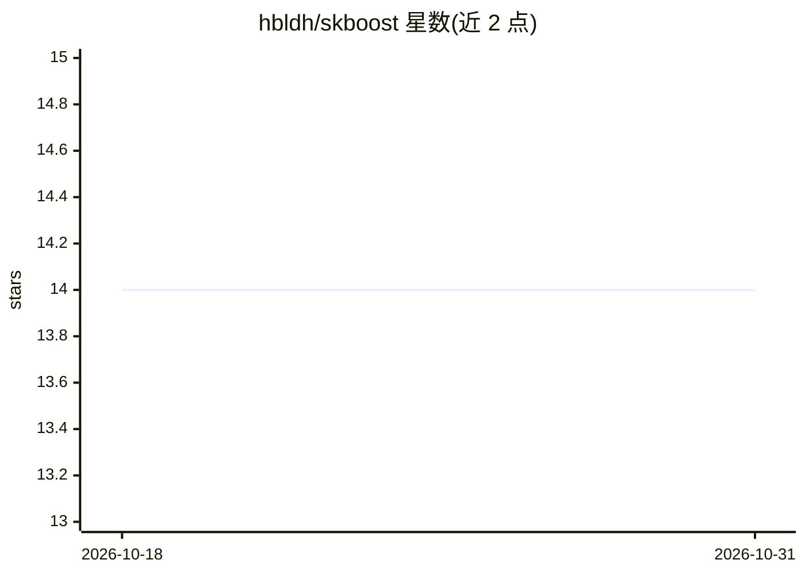

# hbldh/skboost

⭐ 14 · Python · MIT · 推送 2026-07-06 · [GitHub](https://github.com/hbldh/skboost) · 个人维护

**兼容 scikit-learn 的 boosting 算法库，含 MILBoost**

Python 包 skboost，提供 scikit-learn 范围之外的若干 boosting 算法实现，核心是 MILBoost（多示例学习公式化的 boosting），另含 GentleBoost 与 LogitBoost。仓库内附带 MUSK 数据集版本 1 与 2（92 个分子、166 维特征），用于多示例学习基准测试。README 未给出安装命令，仅标注 Build and test 一节；各算法均附论文出处。

## 筛选速览

| 维度 | 判定 | 备注 |
|---|---|---|
| AI 角色 | `ai-native` | 本体是模型或模型工具 |
| 许可风险 | `permissive` | MIT |
| 部署形态 | `None` |  |
| 模型依赖 | — | README 未给出锁定关系 |
| 硬件要求 | — | 无带数字的原话,不猜 |
| 安装摩擦 | `low` | 无编译、无系统依赖或容器化 |
| 成熟度 | — | 结构信号不足 |

## 能力要点

- MILBoost：多示例学习（MIL）公式化的 boosting 算法
- 另含 GentleBoost 与 LogitBoost 实现
- 兼容 scikit-learn 接口
- 内置 MUSK 数据集 v1/v2 用于多示例学习基准

## 适用场景

- 在多示例学习（MIL）任务上训练 boosting 分类器
- 复现或实验 MUSK 分子数据集上的分类基准
- 在 scikit-learn 工作流中使用额外的 boosting 算法

## 场景标签

 · 领域:机器学习/算法库

## 证据(README 行号)

> L5: Boosting Algorithms compatible with scikit-learn.
> L12: The main point of interest is the MILBoost algorithm, which performs boosting
> L13: with a Multiple Instance Learning formulation.

## 星数曲线

2026-10-18 14 → 2026-10-31 14（+0）

---
*卡片 v1 · prompt 1.4 · 生成 2026-10-31 · 置信度 mid · 依据 README sha `999319de7229` · [字段定义](../../DATASET.md)*
