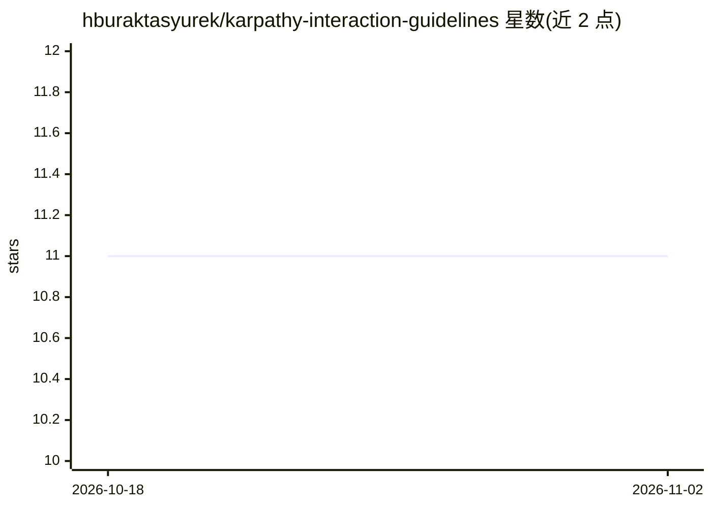

# hburaktasyurek/karpathy-interaction-guidelines

⭐ 11 · Shell · MIT · 推送 2026-08-10 · [GitHub](https://github.com/hburaktasyurek/karpathy-interaction-guidelines) · 个人维护

**面向 AI 编码工具的行为准则（AGENTS.md）与一键安装器**

提供一份五条原则的 LLM 交互行为准则（前 4 条源自 Andrej Karpathy 的观察，第 5 条 Communication 由维护者补充），约束 agent 在不清楚时提问、保持最小改动、以可验证的成功标准执行等。附带 shell 安装器：curl 一行命令即可将规则接入 Claude Code、Codex、OpenCode、Kimi Code、Oh My Pi 等工具的全局配置；Cursor 与 Claude Cowork 因无文件 API 需手动粘贴。另含正误示例文档与项目级安装方式。MIT 许可。

## 筛选速览

| 维度 | 判定 | 备注 |
|---|---|---|
| AI 角色 | `ai-knowledge` | 知识聚合/清单类 |
| 许可风险 | `permissive` | MIT |
| 部署形态 | `None` |  |
| 模型依赖 | locked-api |  |
| 硬件要求 | — | 无带数字的原话,不猜 |
| 安装摩擦 | `low` | 无编译、无系统依赖或容器化 |
| 成熟度 | — | 结构信号不足 |

## 能力要点

- 五条交互原则的 AGENTS.md 准则文本与正误示例文档
- bootstrap 脚本自动接入 Claude Code/Codex/OpenCode/Kimi Code/Oh My Pi 全局配置
- 为 Oh My Pi 生成原生 SKILL.md 技能，采用 marker-merge 避免覆盖用户内容
- 支持全局与单项目两种安装方式，路径可用环境变量覆盖

## 适用场景

- 让 AI 编码助手在需求不清时主动提问而非静默假设
- 统一多个编码 agent 工具的交互与改动规范
- 在单个仓库内启用项目级行为准则

## 场景标签

`提示工程` · 领域:Agent 开发

## 证据(README 行号)

> L11: 1. **Think Before Acting** — Surface assumptions and tradeoffs; ask when unclear instead of guessing silently.
> L94: Principles 1–4 derived from forrestchang/andrej-karpathy-skills (`2c606141936f1eeef17fa3043a72095b4765b9c2`), based

## 星数曲线

2026-10-18 11 → 2026-11-02 11（+0）

---
*卡片 v1 · prompt 1.4 · 生成 2026-11-02 · 置信度 high · 依据 README sha `011d1449196e` · [字段定义](../../DATASET.md)*
