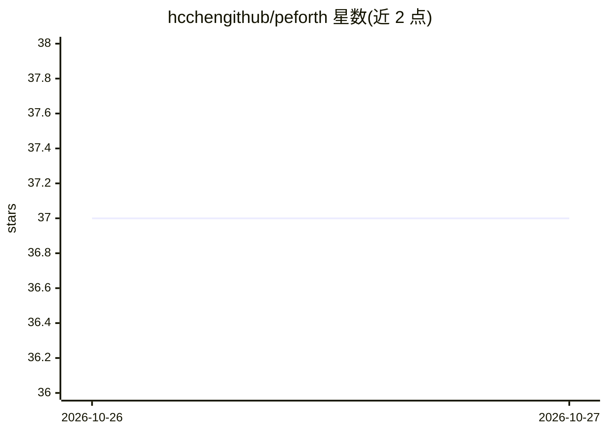

# hcchengithub/peforth

⭐ 37 · Python · MIT · 推送 2026-10-26 · [GitHub](https://github.com/hcchengithub/peforth) · [官网](https://hcchengithub.github.io/peforth/) · 个人维护 · 中文 README

**AI 辅助的 Python 宿主 Forth 环境：REPL 中用 AI 帮写并执行 Forth**

用 Python 托管的 Forth 解释器与终端 REPL，单个 `f` 命令进入；提供 `code ... end-code` 在 Forth 中嵌入宿主 Python、协作式 Task 暂停恢复、字典自省等 Project K 内核能力。可选接入 OpenAI Agents API，在 `chat` 模式对话并可提出 Forth 动作，经本地批准后在活动 VM 中执行；无 API key 时普通 Forth 功能可独立使用。通过 git clone 源码加 uv 可编辑安装，非 PyPI 发布。v2 为重写，不兼容 v1 部分接口。

## 筛选速览

| 维度 | 判定 | 备注 |
|---|---|---|
| AI 角色 | `ai-enhanced` | 去掉 AI 部分产品仍成立 |
| 许可风险 | `permissive` | MIT |
| 部署形态 | `desktop` | 安装包/桌面程序 |
| 模型依赖 | — | README 未给出锁定关系 |
| 硬件要求 | — | 无带数字的原话,不猜 |
| 安装摩擦 | `low` | 无编译、无系统依赖或容器化 |
| 成熟度 | — | 结构信号不足 |

## 能力要点

- `code ... end-code` 直接嵌入宿主 Python，无需独立 FFI 运行时
- OpenAI Agents API 集成：AI 可提出 Forth 动作，经批准后在活动 VM 执行
- Project K 内核：协作式 Task、输入流、字典自省
- CLI 支持 -e 执行、-l 加载多个 Forth 源文件与诊断监控

## 适用场景

- 在 REPL 中交互式编写和调试 Forth，随时可请 AI 解释或代写代码
- 在 Forth 中直接调用 Python 库完成胶水脚本任务
- 通过诊断监控查看运行时与 AI 事件的 SQLite 日志

## 场景标签

`代码生成` · 领域:编码与开发

## 证据(README 行号)

> L3: **peforth is an AI-first Forth environment hosted by Python.** It combines a small extensible Forth kernel, direct a
> L26: - An OpenAI Platform API key **only if you want AI features**. Ordinary Forth execution works without one.

## 星数曲线

2026-10-26 37 → 2026-10-27 37（+0）

---
*卡片 v1 · prompt 1.4 · 生成 2026-10-27 · 置信度 mid · 依据 README sha `2867b5b4bd67` · [字段定义](../../DATASET.md)*
