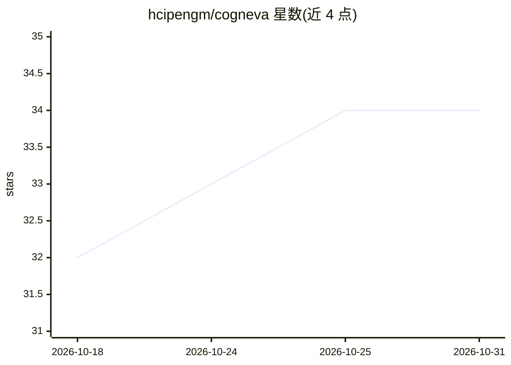

# hcipengm/cogneva

⭐ 34 · Rust · NOASSERTION · 推送 2026-10-30 · [GitHub](https://github.com/hcipengm/cogneva) · 个人维护 · 中文 README

**分布式 AI 多智能体自治系统：自启动、自运行、自进化的数字员工框架**

Rust 编写的分布式 AI 多智能体自治系统，围绕三阶段能力组织：元启动（单条 bootstrap.sh 在空白 Linux 机器上探测环境、自适应选择 K3s/K8s 部署并自修复依赖）；真自治（cog-orchestrator 目标分解、cog-agent ReAct 内核、Squad 自组织协作，无预设 DAG，事件总线驱动）；全进化（源码级 + 制品级双轨演化，带 A/B 统计验证与沙箱内 git apply/cargo test/原子切换、失败自动回滚）。进化输入来自 WebUI/API/GitHub issue 与系统自省，支持 A2A 协议接入。需 Rust 1.85+，系统处于自评 R4 阶段（其自定标尺，非行业标准）。

## 筛选速览

| 维度 | 判定 | 备注 |
|---|---|---|
| AI 角色 | `ai-ecosystem` | LLM/agent 周边工具 |
| 许可风险 | `none` | NOASSERTION |
| 部署形态 | `self-host` | docker 或自建部署 |
| 模型依赖 | — | README 未给出锁定关系 |
| 硬件要求 | — | 无带数字的原话,不猜 |
| 安装摩擦 | `low` | 无编译、无系统依赖或容器化 |
| 成熟度 | `idea` | |

## 能力要点

- 单命令 bootstrap.sh 从空白 Linux 机器自适应部署 K3s/K8s
- 无预设 DAG 的多 Agent 事件总线协作与自愈（Respawner/BinarySwitcher）
- 源码级+制品级双轨自我进化，A/B 统计显著性验证与自动回滚
- A2A 协议接口与 GitHub issue/PR 外部进化输入

## 适用场景

- 让数字员工 7×24 小时朝目标自主执行长周期任务
- 搭建可自我部署、自我修复、自我改进的 AI 基础设施
- 通过 WebUI/API/A2A 下达目标并跟踪系统自主执行

## 场景标签

`多智能体` `Agent 框架` · 领域:Agent 开发

## 证据(README 行号)

> L16: Cogneva (pronounced /kɒɡˈneɪvə/), from **Cognition** + **Emerge** + **Nova**, is a **distributed AI multi-agent aut
> L34: - **Bootstrapping architecture**: a minimal Rust bootstrapper acts as the "seed of the system". It checks itself, r
> L46: - **Decision layer**: `cog-orchestrator` decomposes goals into tasks; `MetaLearning` recommends strategies based on

## 星数曲线

2026-10-18 32 → 2026-10-31 34（+2）

---
*卡片 v1 · prompt 1.4 · 生成 2026-10-25 · 置信度 mid · 依据 README sha `55ffa6ee9569` · [字段定义](../../DATASET.md)*
