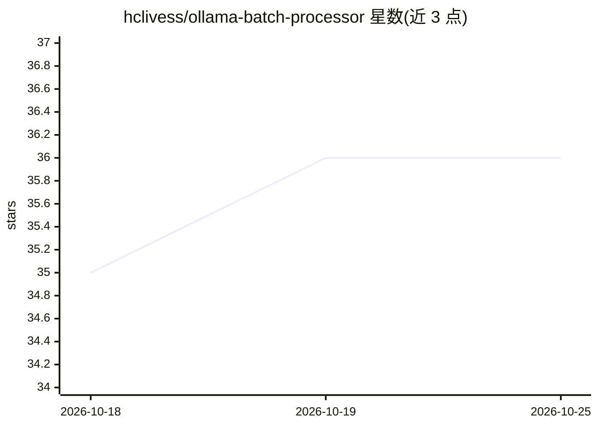

# hclivess/ollama-batch-processor

⭐ 36 · Python · MIT · 推送 2026-08-23 · [GitHub](https://github.com/hclivess/ollama-batch-processor) · 个人维护

**PySide6 桌面应用：经 Ollama 整本书翻译、有声书备稿与清理**

面向终端用户的本地 LLM 批处理 GUI：将 .txt/.md/.srt 等文件或文件夹排队，按操作管道（翻译、有声书准备、去排版、改写）逐块送入 Ollama 模型处理，每步结果独立保存。机制包括按段落/句子智能分块并按块自动设定 num_ctx、渐进式 .partial 保存、剥离 <think> 块与前导语、翻译以上一段译文作上下文保持术语一致。需自备运行中的 Ollama 服务（可在另一台机器），提供 Windows/Linux/macOS 预编译二进制或 pip 源码运行，操作与提示词通过 config.json 配置。

## 筛选速览

| 维度 | 判定 | 备注 |
|---|---|---|
| AI 角色 | `ai-native` | 本体是模型或模型工具 |
| 许可风险 | `permissive` | MIT |
| 部署形态 | `library` | 以包/库形式分发 |
| 模型依赖 | local-ok | 支持本地模型 |
| 硬件要求 | — | 无带数字的原话,不猜 |
| 安装摩擦 | `low` | 无编译、无系统依赖或容器化 |
| 成熟度 | — | 结构信号不足 |

## 能力要点

- 翻译/有声书/去排版/改写四类操作管道，可自定义新操作
- 按段落分块并按块自动设定 num_ctx，避免静默截断
- 渐进式保存与步骤级输出文件，Stop 保留已完成部分
- 提供 Windows/Linux/macOS 预编译二进制

## 适用场景

- 把整本书经本地模型翻译成另一语言
- 为有声书朗读做数字拼读、缩写展开与标点规范化
- 清理电子书的脚注、页码与页眉页脚

## 场景标签

`AI 写作` · 领域:内容生成

## 证据(README 行号)

> L3: Run whole books through a **local LLM** with Ollama: translate, prepare text for audiobook
> L10: - **Queue** any number of `.txt` / `.md` / `.srt` / … files (or folders), press *Start*, get `name_processed.txt`
> L44: You need a running Ollama with at least one model:

## 星数曲线

2026-10-18 35 → 2026-10-25 36（+1）

---
*卡片 v1 · prompt 1.4 · 生成 2026-10-25 · 置信度 high · 依据 README sha `6d957f976b31` · [字段定义](../../DATASET.md)*
