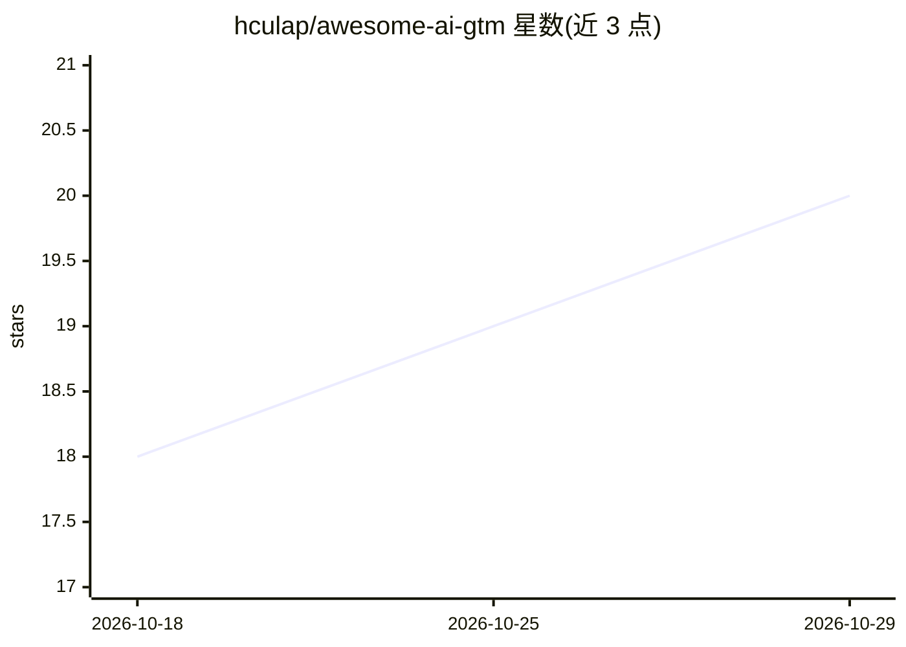

# hculap/awesome-ai-gtm

⭐ 20 · Python · CC0-1.0 · 推送 2026-10-26 · [GitHub](https://github.com/hculap/awesome-ai-gtm) · [官网](https://szymonpaluch.com) · 个人维护

**AI 驱动的 Go-to-Market 工具与 agent 策展清单**

按 GTM 漏斗五阶段（创意与战略、营销与内容、销售转化、管道与支持及后续阶段）组织的 AI agent 与工具策展清单：收录创意生成、市场研究、SEO/内容、文案、图像视频生成、潜客挖掘、多渠道外联、会议排期等类别下的商业产品条目，每条附一句话说明。另配一篇分阶段讲解漏斗与人工交接点的长文（含波兰语版）。面向构建自动化 GTM 流程的创业者、市场与销售人员。

## 筛选速览

| 维度 | 判定 | 备注 |
|---|---|---|
| AI 角色 | `ai-knowledge` | 知识聚合/清单类 |
| 许可风险 | `viral` | CC0-1.0 |
| 部署形态 | `None` |  |
| 模型依赖 | — | README 未给出锁定关系 |
| 硬件要求 | — | 无带数字的原话,不猜 |
| 安装摩擦 | `low` | 无编译、无系统依赖或容器化 |
| 成熟度 | — | 结构信号不足 |

## 能力要点

- 按 GTM 漏斗阶段组织条目（创意→营销→转化→成交→支持）
- 覆盖创意、市场研究、SEO/内容、文案、图像视频、潜客挖掘、外联、排期等类别
- 配套长文讲解各阶段 AI 接管范围与四个人工交接点

## 适用场景

- 搭建自动化 GTM 流程时按阶段查找 AI 工具
- 对比销售外联与潜客挖掘类 AI agent 产品
- 了解 GTM 各环节哪些环节仍需人工介入

## 场景标签

`精选清单` · 领域:学习与行业

## 证据(README 行号)

> L3: > A curated list of AI agents and tools for building an autonomous Go-to-Market (GTM) funnel
> L5: The AI landscape is shifting from simple tools to sophisticated agents that can manage complex, multi-step workflows

## 星数曲线

2026-10-18 18 → 2026-10-29 20（+2）

---
*卡片 v1 · prompt 1.4 · 生成 2026-10-28 · 置信度 high · 依据 README sha `dd75f1f64928` · [字段定义](../../DATASET.md)*
