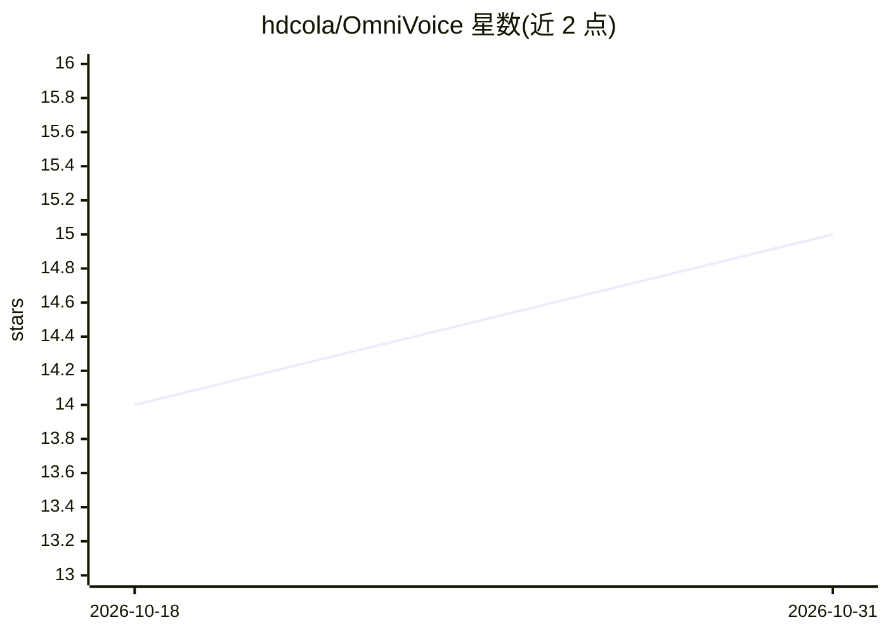

# hdcola/OmniVoice

⭐ 15 · Swift · Apache-2.0 · 推送 2026-10-19 · [GitHub](https://github.com/hdcola/OmniVoice) · 个人维护 · 中文 README

**macOS 端上实时转写、翻译与语音输入菜单栏应用**

面向 macOS 用户的菜单栏应用：悬浮字幕面板实时转写与翻译音频（可含系统声音）、⌥A 划词翻译、⌥S 截图 OCR 翻译、按住右 ⌥ 键在任何应用内语音输入，可选 LLM 润色标点与口语词。语音识别与翻译可选用 macOS 内建框架或本地模型（经 audio.cpp / llama.cpp / sherpa-onnx 进程内运行），默认无需云服务。要求 macOS 26+，UI 目前仅中文，0.10.0 为内部测试版，未公证，需手动清除隔离标记。

## 筛选速览

| 维度 | 判定 | 备注 |
|---|---|---|
| AI 角色 | `ai-native` | 本体是模型或模型工具 |
| 许可风险 | `permissive` | Apache-2.0 |
| 部署形态 | `desktop` | 安装包/桌面程序 |
| 模型依赖 | local-ok | 支持本地模型 |
| 硬件要求 | — | 无带数字的原话,不猜 |
| 安装摩擦 | `low` | 无编译、无系统依赖或容器化 |
| 成熟度 | `idea` | |

## 能力要点

- 悬浮字幕面板双语/单语实时转写与翻译，可含 ScreenCaptureKit 系统音频
- ⌥A 划词翻译与 ⌥S 截图本地 OCR 翻译，全程端上运行
- 按住右 ⌥ 键任意应用语音输入，可选 LLM 润色（OpenAI 兼容服务，默认关闭）
- Model Library 下载本地模型（R2T2 / HY-MT1.5 等，含 SHA-256 校验与内存占用展示）

## 适用场景

- 听讲座或开多语会议时看实时双语字幕并导出 Markdown 记录
- 划词或截图即时翻译外文内容
- 在聊天或文档里用语音输入并先审阅译文再上屏

## 场景标签

`语音识别` `OCR` · 领域:感知与多模态

## 证据(README 行号)

> L10: app. Speech recognition and translation run on macOS's built-in frameworks
> L105: |Speech recognition|`SpeechAnalyzer` / `SpeechTranscriber`|R2T2 (Q4_K_M / Q8_0 / F16) via audio.cpp; small streami

## 星数曲线

2026-10-18 14 → 2026-10-31 15（+1）

---
*卡片 v1 · prompt 1.4 · 生成 2026-10-30 · 置信度 high · 依据 README sha `d2a96ebc7964` · [字段定义](../../DATASET.md)*
