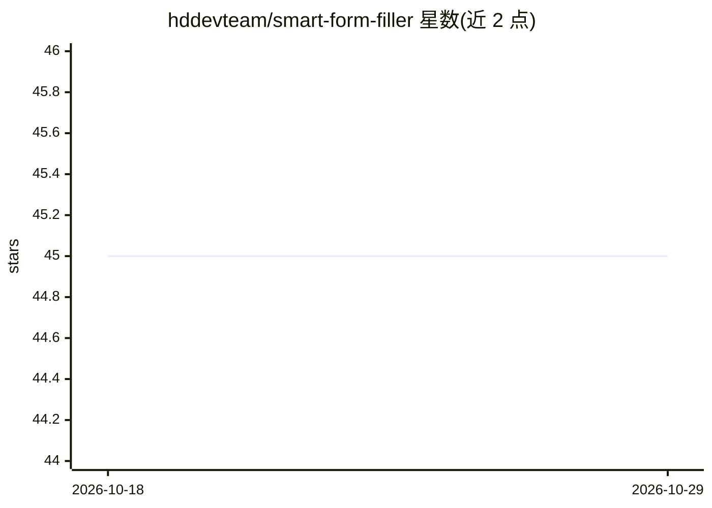

# hddevteam/smart-form-filler

⭐ 45 · JavaScript · ISC · 推送 2026-06-30 · [GitHub](https://github.com/hddevteam/smart-form-filler) · [官网](https://hddevteam.github.io/smart-form-filler/) · 组织维护 · 中文 README

**AI 驱动的浏览器扩展：网页数据提取与自动填表**

Chrome/Chromium 浏览器扩展，用 AI 完成网页结构化数据提取与表单自动填写，支持字段智能映射、下拉/单选/复选选项分析，输出原始 HTML、清洗 HTML 与 Markdown 三种格式，并可对提取内容进行对话问答。模型支持 Ollama 本地模型与 GPT-4o、DeepSeek 等云端模型，通过自带设置界面配置后端连接（默认 localhost:3001）。安装需 Node.js 后端并以开发者模式加载扩展目录。

## 筛选速览

| 维度 | 判定 | 备注 |
|---|---|---|
| AI 角色 | `ai-native` | 本体是模型或模型工具 |
| 许可风险 | `permissive` | ISC |
| 部署形态 | `None` |  |
| 模型依赖 | local-ok | 支持本地模型 |
| 硬件要求 | — | 无带数字的原话,不猜 |
| 安装摩擦 | `low` | 无编译、无系统依赖或容器化 |
| 成熟度 | — | 结构信号不足 |

## 能力要点

- AI 表单字段映射与智能自动填写
- 网页结构化数据提取（HTML/Markdown 多格式输出）
- Ollama 本地模型集成，数据不出本机
- 云端模型支持 GPT-4o、o 系列、DeepSeek 等
- 与提取内容对话问答

## 适用场景

- 自动填写复杂网页表单，如反馈问卷
- 从网页提取结构化数据并转成 Markdown
- 不想把数据发给云端时用 Ollama 本地模型处理

## 场景标签

`网页抓取` `浏览器自动化` · 领域:效率与自动化

## 证据(README 行号)

> L3: A standalone browser extension for intelligent data extraction and form filling using AI technology. Now with **Olla
> L27: - **Smart Form Filling**: AI-powered automatic form completion with intelligent field mapping
> L30: - **Local AI Models**: Full Ollama integration for privacy-focused AI

## 星数曲线

2026-10-18 45 → 2026-10-29 45（+0）

---
*卡片 v1 · prompt 1.4 · 生成 2026-10-25 · 置信度 high · 依据 README sha `e18347c588ca` · [字段定义](../../DATASET.md)*
