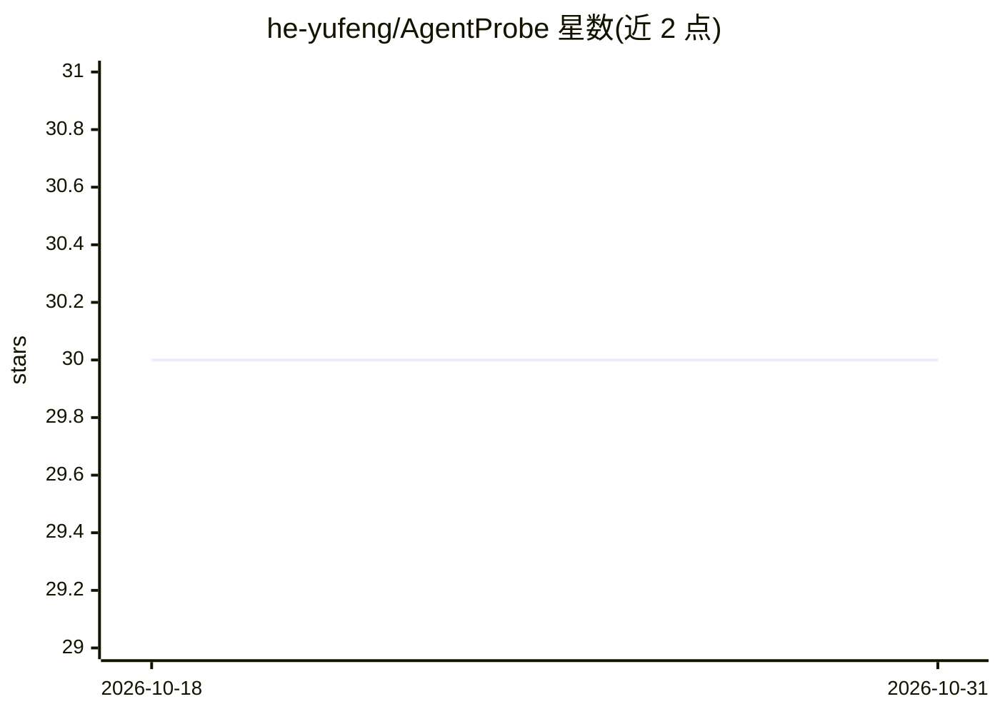

# he-yufeng/AgentProbe

⭐ 30 · Python · MIT · 推送 2026-09-06 · [GitHub](https://github.com/he-yufeng/AgentProbe) · 个人维护 · 中文 README

**AI agent 回归测试的 pytest 插件：快照基线与 Mock LLM**

面向 AI agent 开发者的回归测试工具：一个装饰器捕获 agent 输出并存为基线快照，后续运行按精确匹配或语义相似度（3-gram 余弦 / sentence-transformers）对比，变更即测试失败。内置 MockLLM 替换 openai.Client 返回脚本化响应（支持 async、流式、失败注入），无需 API key；另提供工具调用断言、Pydantic schema 校验、多步 Trace、成本预算断言，自动注册为 pytest 插件，可导出 EvalPort ResultSet。

## 筛选速览

| 维度 | 判定 | 备注 |
|---|---|---|
| AI 角色 | `ai-ecosystem` | LLM/agent 周边工具 |
| 许可风险 | `permissive` | MIT |
| 部署形态 | `library` | 以包/库形式分发 |
| 模型依赖 | — | README 未给出锁定关系 |
| 硬件要求 | — | 无带数字的原话,不猜 |
| 安装摩擦 | `low` | 无编译、无系统依赖或容器化 |
| 成熟度 | — | 结构信号不足 |

## 能力要点

- 装饰器快照基线，支持 exact/fuzzy/semantic 三种对比模式
- MockLLM 替换 openai.Client，无 API key 即可确定性测试
- 工具调用断言（次数/顺序/参数子集/危险参数）与成本预算断言
- 快照差异统一 diff 展示，agentprobe diff/accept 本地审阅漂移

## 适用场景

- 改 prompt、换模型或升级依赖后，在 CI 中发现 agent 行为回归
- 不发真实 API 请求即可离线测试 agent 逻辑与失败处理
- 限定单次运行的 token 成本上限，拦截变贵的回归

## 场景标签

`模型评测` · 领域:评测与运维

## 证据(README 行号)

> L17: **AgentProbe** fixes this. One decorator captures your agent's output and saves it as a baseline snapshot. On the n

## 星数曲线

2026-10-18 30 → 2026-10-31 30（+0）

---
*卡片 v1 · prompt 1.4 · 生成 2026-10-26 · 置信度 high · 依据 README sha `bd6a2dcbc29b` · [字段定义](../../DATASET.md)*
