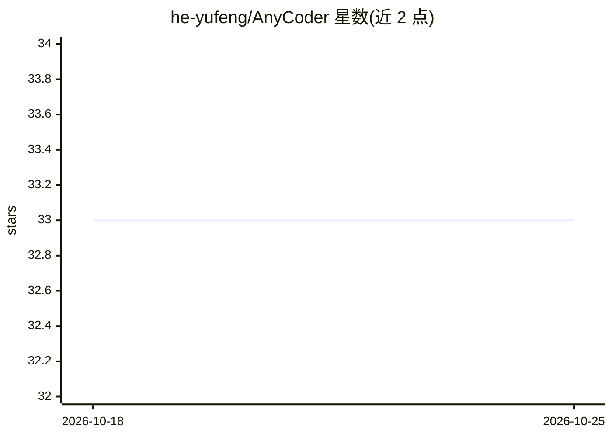

# he-yufeng/AnyCoder

⭐ 33 · Python · MIT · 推送 2026-10-22 · [GitHub](https://github.com/he-yufeng/AnyCoder) · [官网](https://pypi.org/project/anycoder/) · 个人维护 · 中文 README

**终端 AI 编程助手：一个 CLI 接入 100+ 模型写代码**

Python 实现的终端编码 agent（约 1,600 行），通过 litellm 支持 DeepSeek、Qwen、GPT-5、Claude、Gemini、Kimi、GLM 及 Ollama 本地模型等 100+ 提供商。内置 8 个工具（bash、读写/编辑文件、apply_patch、glob、grep、run_tests），agent 循环自动调用；支持流式输出、两阶段上下文压缩、危险命令拦截、会话持久化与计划模式。以 pip 安装，也可作为 Python 库使用；README 附与 Claude Code/Cline/Aider 的功能对比表。

## 筛选速览

| 维度 | 判定 | 备注 |
|---|---|---|
| AI 角色 | `ai-native` | 本体是模型或模型工具 |
| 许可风险 | `permissive` | MIT |
| 部署形态 | `library` | 以包/库形式分发 |
| 模型依赖 | local-ok | 支持本地模型 |
| 硬件要求 | — | 无带数字的原话,不猜 |
| 安装摩擦 | `low` | 无编译、无系统依赖或容器化 |
| 成熟度 | — | 结构信号不足 |

## 能力要点

- 经 litellm 接入 100+ LLM 提供商，含 Ollama 本地模型与自定义 OpenAI 兼容 API
- 8 个内置工具的 agent 循环（bash/文件编辑/补丁/搜索/测试运行）
- 两阶段上下文压缩（先裁剪工具输出再摘要旧对话）
- 危险命令拦截与并行工具执行、会话保存与恢复

## 适用场景

- 在终端用自然语言让 AI 读代码、改文件、跑测试
- 接入便宜或本地（Ollama）模型做编程助手
- 作为可阅读源码的小型 agent 库二次开发

## 场景标签

`编码 Agent` · 领域:编码与开发

## 证据(README 行号)

> L12: DeepSeek, Qwen, GPT-5, Claude, Gemini, Kimi, GLM, Ollama local models - pick your favorite and start coding.
> L29: - **100+ LLM providers** via litellm - one CLI, any model
> L30: - **Agent loop with tool use** - reads files, writes code, runs commands, searches codebases

## 星数曲线

2026-10-18 33 → 2026-10-25 33（+0）

---
*卡片 v1 · prompt 1.4 · 生成 2026-10-25 · 置信度 high · 依据 README sha `e3c43ecb516e` · [字段定义](../../DATASET.md)*
