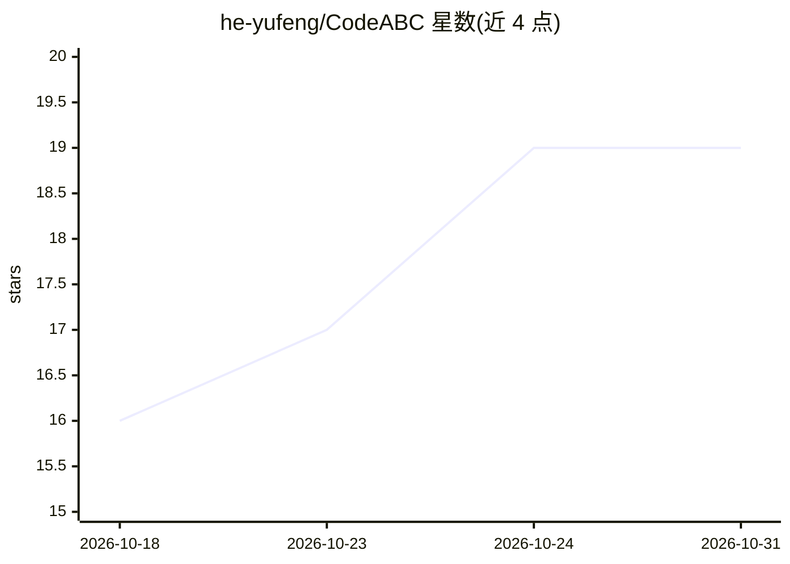

# he-yufeng/CodeABC

⭐ 19 · Python · MIT · 推送 2026-10-29 · [GitHub](https://github.com/he-yufeng/CodeABC) · 个人维护 · 中文 README

**面向非程序员的 AI 代码阅读器：像读文章一样读懂代码**

基于 React + FastAPI 的 Web 应用：用户拖入项目文件夹或粘贴 GitHub 链接，先以确定性算法（无需 API key）生成阅读地图、核心模块排名（按 fan-in）、测试覆盖视图、术语词典等，再叠加 LLM 生成的白话项目手册、逐行悬停注释、片段问答、自然语言改写建议与全项目对话。还提供错误堆栈定位、前后文件夹对比、外部依赖与静默失败点扫描。扫描时跳过构建产物与密钥类文件。

## 筛选速览

| 维度 | 判定 | 备注 |
|---|---|---|
| AI 角色 | `ai-native` | 本体是模型或模型工具 |
| 许可风险 | `permissive` | MIT |
| 部署形态 | `self-host` | docker 或自建部署 |
| 模型依赖 | locked-api |  |
| 硬件要求 | — | 无带数字的原话,不猜 |
| 安装摩擦 | `low` | 无编译、无系统依赖或容器化 |
| 成熟度 | — | 结构信号不足 |

## 能力要点

- 确定性阅读地图、核心模块排名、测试覆盖等无需 API key 即可生成
- 1-3 行粒度的 AI 悬停注释，本地缓存
- 堆栈追踪定位与自然语言改写建议（不写回文件）
- 外部服务依赖、静默失败点、未调用函数等风险扫描

## 适用场景

- 非程序员审阅外包代码或数据脚本
- 产品经理/创始人了解项目结构与代码质量
- 读不懂的代码片段直接提问或请求改写

## 场景标签

`代码审查` `AI 助手` · 领域:编码与开发

## 证据(README 行号)

> L9: **Read code without learning to code.** An AI-powered code reader built for non-programmers.
> L23: Drop in a folder or paste a GitHub link. CodeABC scans the project (skipping build output, caches, and secret-shape

## 星数曲线

2026-10-18 16 → 2026-10-31 19（+3）

---
*卡片 v1 · prompt 1.4 · 生成 2026-10-28 · 置信度 mid · 依据 README sha `c56bf9414e40` · [字段定义](../../DATASET.md)*
