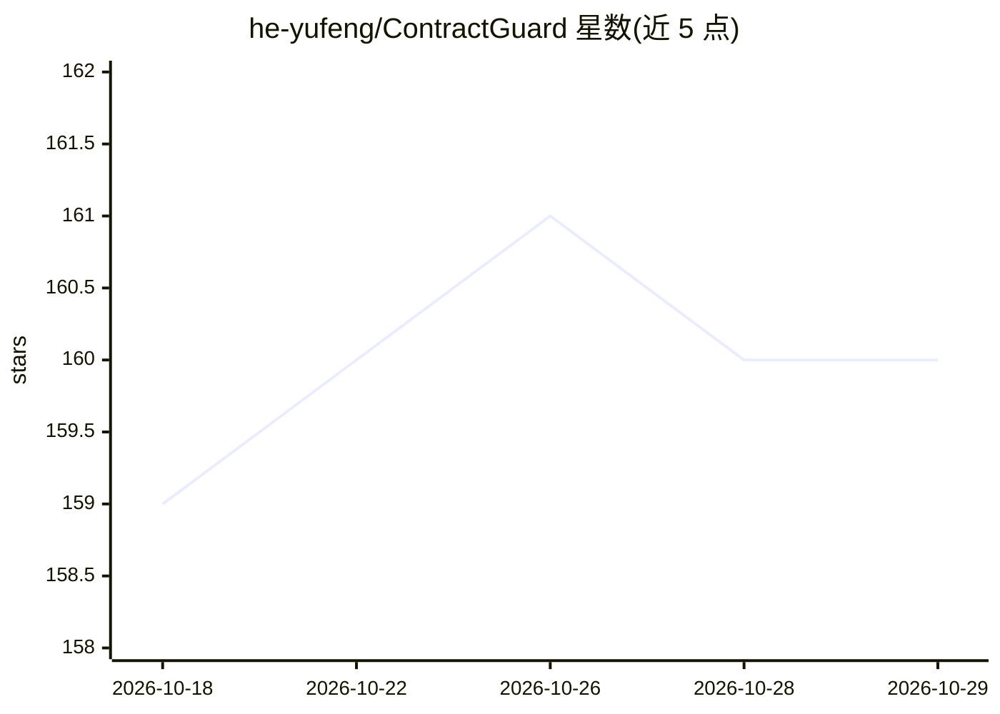

# he-yufeng/ContractGuard

⭐ 160 · Python · MIT · 推送 2026-10-22 · [GitHub](https://github.com/he-yufeng/ContractGuard) · 个人维护 · 中文 README

**给普通签约人的 AI 合同审查 CLI：上传合同即得风险标记与公平评分**

开源命令行 AI agent，解析 PDF/DOCX/TXT 等合同文本，自动识别合同类型（租约、NDA、雇佣、SaaS 等 7 类），将条款分为红旗/警告/保护/缺失保护四类，输出公平评分（A+ 到 F）与可操作的修改建议。附带确定性法规检查清单， jurisdiction-aware，支持中国劳动法/民法典与加州民法规则，结果以 violation/ok/unknown 报告。通过 OpenAI 兼容 API 接入任意 LLM（OpenRouter/OpenAI/Ollama 本地等），Python 3.10+，pip 安装，约 3 万 token（约 60 页）上限。声明为教育工具非法律意见。

## 筛选速览

| 维度 | 判定 | 备注 |
|---|---|---|
| AI 角色 | `ai-native` | 本体是模型或模型工具 |
| 许可风险 | `permissive` | MIT |
| 部署形态 | `library` | 以包/库形式分发 |
| 模型依赖 | local-ok | 支持本地模型 |
| 硬件要求 | — | 无带数字的原话,不猜 |
| 安装摩擦 | `low` | 无编译、无系统依赖或容器化 |
| 成熟度 | — | 结构信号不足 |

## 能力要点

- 四类条款分析（红旗/警告/保护/缺失保护）与 A+ 至 F 公平评分
- 确定性法规检查清单，支持中国与加州规则的 jurisdiction-aware 判定
- CLI 优先设计，支持 --json 与 CI/CD 集成
- 通过 OpenAI 兼容 API 接入 OpenRouter/OpenAI/Ollama 本地模型

## 适用场景

- 签租约或雇佣合同前快速筛查不利条款
- 用本地 Ollama 模型私有化审查保密合同
- 在 CI/CD 中对合同文档做结构化解析输出

## 场景标签

`文档解析` · 领域:知识与检索

## 证据(README 行号)

> L16: **ContractGuard** changes that. It's an open-source AI agent that reads every clause of your contract, flags proble
> L130: 3. **Analyze** — The AI agent reviews every clause and categorizes findings into four groups:

## 星数曲线

2026-10-18 159 → 2026-10-29 160（+1）

---
*卡片 v1 · prompt 1.4 · 生成 2026-10-22 · 置信度 high · 依据 README sha `a7c65dbb8435` · [字段定义](../../DATASET.md)*
