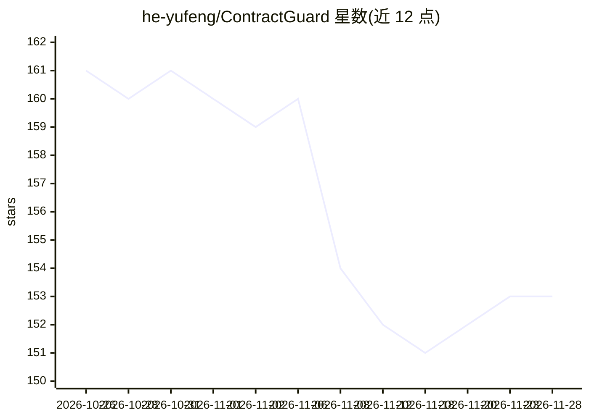

# he-yufeng/ContractGuard

⭐ 153 · Python · MIT · 推送 2026-10-22 · [GitHub](https://github.com/he-yufeng/ContractGuard) · 个人维护 · 中文 README

**面向普通人的合同风险 AI 审查 CLI：上传合同即出红旗条款与公平评分**

命令行 AI agent：读取 PDF/DOCX/TXT 等格式合同，解析文本后交由 LLM 自动识别合同类型（租约、NDA、雇佣、SaaS 条款、借贷等），将发现归类为红旗、警告、保护条款与缺失保护四类，并给出 A+ 至 F 的公平评分。另并行运行确定性的法条核查清单，支持按管辖区（cn / us-ca）检查试用期、违约金、押金上限等规则。通过 OpenAI 兼容 API 接入任意 LLM，支持 Ollama 本地运行。README 明确声明其输出不构成法律意见。

## 筛选速览

| 维度 | 判定 | 备注 |
|---|---|---|
| AI 角色 | `ai-native` | 本体是模型或模型工具 |
| 许可风险 | `permissive` | MIT |
| 部署形态 | `library` | 以包/库形式分发 |
| 模型依赖 | local-ok | 支持本地模型 |
| 硬件要求 | — | 无带数字的原话,不猜 |
| 安装摩擦 | `low` | 无编译、无系统依赖或容器化 |
| 成熟度 | — | 结构信号不足 |

## 能力要点

- 四类结构化输出：红旗/警告/保护/缺失保护，附公平评分（A+–F）
- 确定性法条清单与 LLM 并行核查，管辖区自动检测（cn / us-ca）
- 支持 PDF/DOCX/TXT/MD/RTF，扫描版 PDF 走 OCR
- --json 输出 Pydantic 结构化结果，可接入 CI/CD

## 适用场景

- 签租约或 NDA 前快速查看红旗条款和谈判建议
- 审查雇佣合同中的竞业限制与知识产权归属
- 本地 Ollama 模式下离线审查涉密合同

## 场景标签

`文档解析` · 领域:知识与检索

## 证据(README 行号)

> L16: **ContractGuard** changes that. It's an open-source AI agent that reads every clause of your contract, flags proble
> L130: 3. **Analyze** — The AI agent reviews every clause and categorizes findings into four groups:
> L146: ContractGuard uses the OpenAI-compatible API format, so it works with virtually any LLM provider:

## 星数曲线

2026-10-26 161 → 2026-11-28 153（-8）

---
*卡片 v1 · prompt 1.4 · 生成 2026-11-27 · 置信度 high · 依据 README sha `004c6c3566cc` · [字段定义](../../DATASET.md)*
