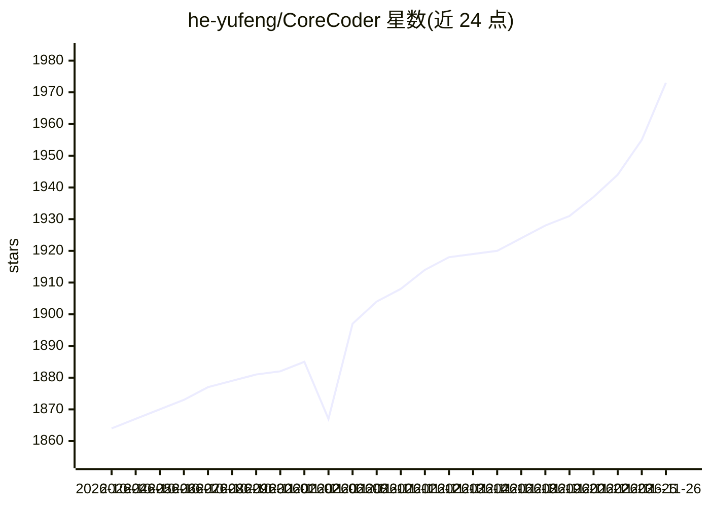

# he-yufeng/CoreCoder

⭐ 1,973 · Python · MIT · 推送 2026-11-25 · [GitHub](https://github.com/he-yufeng/CoreCoder) · [官网](https://pypi.org/project/corecoder/) · 个人维护 · 中文 README

**约千行 Python 的极简 AI 编码 agent，供阅读与二次开发**

受 Claude Code 启发的极简编码 agent，引擎约 1,614 行、全包 3,603 行纯 Python，定位类似编码 agent 领域的 nanoGPT：让读者一个下午读完整个引擎，理解编码 agent 的运作机制后 fork 出自己的版本。功能上可实际运行：读写文件、执行 shell、生成子 agent、三级上下文压缩、显示 token 花费，并提供 plan mode、hooks、checkpoints；磁盘变更与命令执行前需用户确认。默认讲 OpenAI 兼容 API，可用两个环境变量切换提供商，另有可选 LiteLLM 后端。附 449 个离线测试与 8 篇中英双语解读文章。

## 筛选速览

| 维度 | 判定 | 备注 |
|---|---|---|
| AI 角色 | `ai-ecosystem` | LLM/agent 周边工具 |
| 许可风险 | `permissive` | MIT |
| 部署形态 | `library` | 以包/库形式分发 |
| 模型依赖 | local-ok | 支持本地模型 |
| 硬件要求 | — | 无带数字的原话,不猜 |
| 安装摩擦 | `low` | 无编译、无系统依赖或容器化 |
| 成熟度 | — | 结构信号不足 |

## 能力要点

- 引擎约 1,614 行纯 Python，全包 26 文件可一次读完
- 八个工具（bash/read_file/write_file/edit_file/glob/grep/todo_write/agent）构成完整 agent 循环
- 三级上下文压缩（50%/70%/90% 阶梯式瘦身）与子 agent 隔离机制
- 通过环境变量切换 OpenAI/DeepSeek/Ollama 等提供商，可选 LiteLLM 后端

## 适用场景

- 想读懂并 fork 一个极简编码 agent 的开发者
- 教学场景中演示 coding agent 核心循环的工作原理
- 基于最小核心实验 plan mode、hooks、子 agent 等机制

## 场景标签

`编码 Agent` · 领域:编码与开发

## 证据(README 行号)

> L3: **The nanoGPT of coding agents. A 1.6k-line engine inside 3,603 readable lines of pure Python: understand how a codi
> L37: And it really runs: reads and writes files, executes shell, spawns sub-agents, compacts context in three tiers, and
> L60: Give it a model and a key and it goes. It speaks the OpenAI-compatible API by default, and switching providers is u

## 星数曲线

2026-10-24 1,864 → 2026-11-26 1,973（+109）

---
*卡片 v1 · prompt 1.4 · 生成 2026-11-26 · 置信度 high · 依据 README sha `7d8eef2b5b1e` · [字段定义](../../DATASET.md)*
