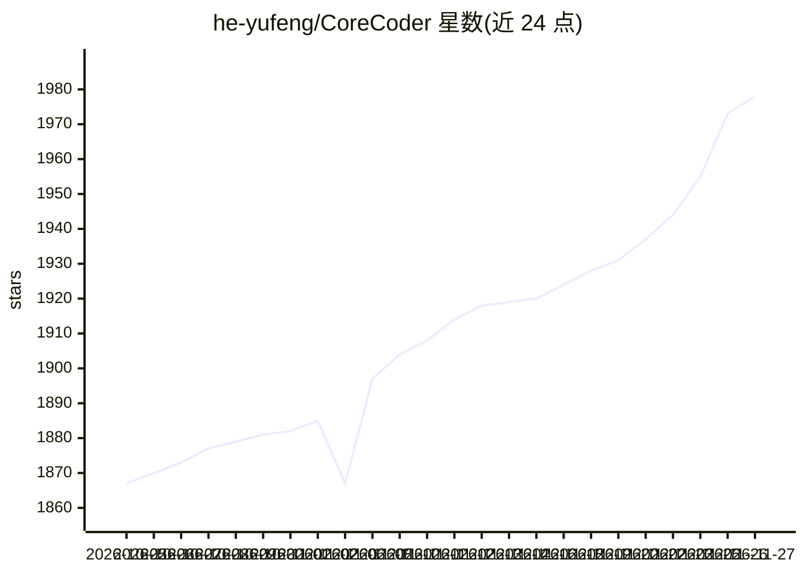

# he-yufeng/CoreCoder

⭐ 1,978 · Python · MIT · 推送 2026-11-26 · [GitHub](https://github.com/he-yufeng/CoreCoder) · [官网](https://pypi.org/project/corecoder/) · 个人维护 · 中文 README

**千余行可读的极简 AI 编码 agent，供学习后自行分叉**

受 Claude Code 启发、以约 1,650 行引擎（全包 3,688 行纯 Python）实现的极简编码 agent，定位类似 nanoGPT：目标是让人一个下午读完整个 agent 引擎，再据此分叉出自己的版本。功能上可真实运行：读写文件、执行 shell、生成子 agent、三级上下文压缩、报告 token 花费，危险操作前需用户确认；提供 plan mode、hooks 与 checkpoints，另附 8 篇中英双语源码解读文章。通过 OpenAI 兼容 API 接入任意模型。

## 筛选速览

| 维度 | 判定 | 备注 |
|---|---|---|
| AI 角色 | `ai-native` | 本体是模型或模型工具 |
| 许可风险 | `permissive` | MIT |
| 部署形态 | `library` | 以包/库形式分发 |
| 模型依赖 | local-ok | 支持本地模型 |
| 硬件要求 | — | 无带数字的原话,不猜 |
| 安装摩擦 | `low` | 无编译、无系统依赖或容器化 |
| 成熟度 | `idea` | |

## 能力要点

- 约 1,650 行引擎，端到端可读可打断点修改
- 8 个内置工具（bash/读写编辑文件/glob/grep/todo/sub-agent），可挂载 MCP 服务器
- 三级上下文压缩（50%/70%/90% 分层裁剪）与 provider 故障时的有序回退链
- edit_file 采用唯一片段锚定的搜索替换并返回 diff

## 适用场景

- 读懂一个编码 agent 的内部机制再改造成自己的版本
- 在本地终端用自选模型让 agent 修复和编辑代码文件
- 作为教学参考演示 agent 主循环与工具调用的工程细节

## 场景标签

`编码 Agent` · 领域:编码与开发

## 证据(README 行号)

> L3: **The nanoGPT of coding agents. A 1.6k-line engine inside 3,688 readable lines of pure Python: understand how a codi
> L37: And it really runs: reads and writes files, executes shell, spawns sub-agents, compacts context in three tiers, and
> L44:  These thousand lines really do run a full loop end to end: ask it to fix buggy.py and it reads the file, edits the

## 星数曲线

2026-10-25 1,867 → 2026-11-27 1,978（+111）

---
*卡片 v1 · prompt 1.4 · 生成 2026-11-27 · 置信度 high · 依据 README sha `de084a3d945e` · [字段定义](../../DATASET.md)*
