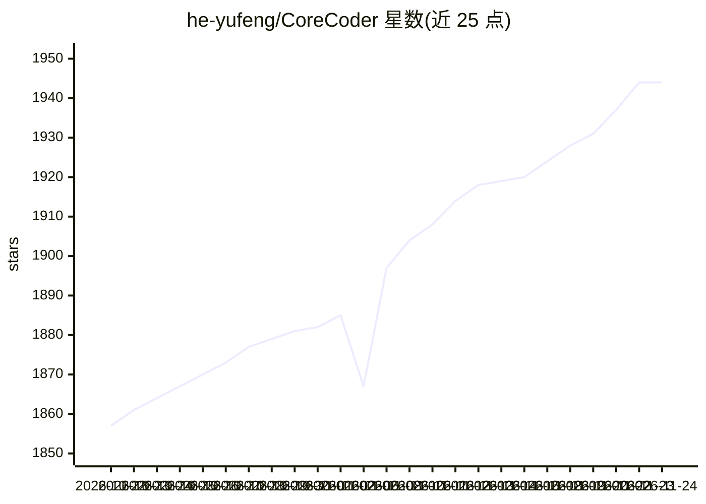

# he-yufeng/CoreCoder

⭐ 1,955 · Python · MIT · 推送 2026-11-23 · [GitHub](https://github.com/he-yufeng/CoreCoder) · [官网](https://pypi.org/project/corecoder/) · 个人维护 · 中文 README

**千行级可读 Python 编码 agent，供学习后 fork**

用约 1,532 行引擎（全包 3,492 行 Python）实现的最小编码 agent：主循环围绕 LLM 与 8 个工具（bash、读写/编辑文件、glob、grep、todo、子 agent）运转，可读写文件、执行 shell、生成子 agent，三级上下文压缩，支持 plan mode、hooks、checkpoints，附带 422 个离线测试。默认走 OpenAI 兼容 API，切换供应商仅需两个环境变量，可选 LiteLLM 后端。定位是可读参考实现，供阅读源码后 fork 改造，而非日常生产力工具。

## 筛选速览

| 维度 | 判定 | 备注 |
|---|---|---|
| AI 角色 | `ai-native` | 本体是模型或模型工具 |
| 许可风险 | `permissive` | MIT |
| 部署形态 | `library` | 以包/库形式分发 |
| 模型依赖 | local-ok | 支持本地模型 |
| 硬件要求 | — | 无带数字的原话,不猜 |
| 安装摩擦 | `low` | 无编译、无系统依赖或容器化 |
| 成熟度 | — | 结构信号不足 |

## 能力要点

- 引擎约 1,532 行、全包 3,492 行，可在一下午通读并断点修改
- 8 个内置工具 + 可选 MCP 服务器扩展（mcp__* 工具）
- 三级上下文压缩：先裁剪工具输出，再摘要旧轮次，90% 时才强压缩
- edit_file 采用唯一片段搜索替换而非行号，成功时返回 diff

## 适用场景

- 阅读源码理解编码 agent 的工作原理
- 以最小实现为基础 fork 出自己的 agent
- 接入 OpenAI 兼容端点的任意模型跑端到端编码任务

## 场景标签

`编码 Agent` · 领域:编码与开发

## 证据(README 行号)

> L3: **The nanoGPT of coding agents. A 1.5k-line engine inside 3,492 readable lines of pure Python: understand how a codi
> L37: And it really runs: reads and writes files, executes shell, spawns sub-agents, compacts context in three tiers, and

## 星数曲线

2026-10-22 1,857 → 2026-11-24 1,944（+87）

---
*卡片 v1 · prompt 1.4 · 生成 2026-11-24 · 置信度 high · 依据 README sha `28b10676c5e4` · [字段定义](../../DATASET.md)*
