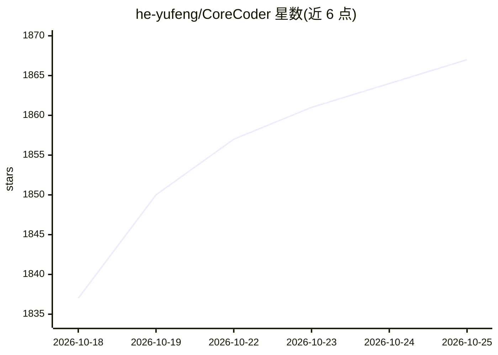

# he-yufeng/CoreCoder

⭐ 1,867 · Python · MIT · 推送 2026-10-19 · [GitHub](https://github.com/he-yufeng/CoreCoder) · [官网](https://pypi.org/project/corecoder/) · 个人维护 · 中文 README

**极简可读的 AI 编码 agent：约 1.3k 行引擎供学习与二次开发**

受 Claude Code 启发的最小化编码 agent，引擎（循环、模型接口、上下文、工具、会话）约 1,322 行，全包 2,816 行，定位是让人读懂编码 agent 的核心后 fork 自己的版本。它可实际运行：通过 OpenAI 兼容 API 接入任意 LLM（DeepSeek、本地 Ollama 等，可用 LiteLLM 后端扩展到上百供应商），内置 bash/读写文件/编辑/子 agent 等 8 个工具，支持三级上下文压缩、计划模式、hooks、MCP 工具接入，危险操作需确认，227 个测试通过。配 8 篇中英双语源码解读文章。

## 筛选速览

| 维度 | 判定 | 备注 |
|---|---|---|
| AI 角色 | `ai-native` | 本体是模型或模型工具 |
| 许可风险 | `permissive` | MIT |
| 部署形态 | `library` | 以包/库形式分发 |
| 模型依赖 | local-ok | 支持本地模型 |
| 硬件要求 | — | 无带数字的原话,不猜 |
| 安装摩擦 | `low` | 无编译、无系统依赖或容器化 |
| 成熟度 | — | 结构信号不足 |

## 能力要点

- 引擎约 1,322 行，可在一个下午读完并可断点调试
- 通过 OpenAI 兼容 API 接入任意 LLM，可选 LiteLLM 后端路由上百供应商
- 8 个工具（含子 agent）+ MCP 服务器扩展 + 三级上下文压缩
- 计划模式、hooks 与检查点，危险操作需用户确认

## 适用场景

- 阅读并理解编码 agent 的内部工作原理
- 以此为起点 fork 一个自己的编码 agent
- 接入 DeepSeek/Ollama 等供应商做代码修复与编辑
- 配合 8 篇双语源码解读文章系统学习 agent 架构

## 场景标签

`编码 Agent` `教程课程` · 领域:编码与开发

## 证据(README 行号)

> L3: **The nanoGPT of coding agents. A 1.3k-line engine inside 2,816 readable lines of pure Python: understand how a codi
> L37: And it really runs: reads and writes files, executes shell, spawns sub-agents, compacts context in three tiers, and
> L60: Give it a model and a key and it goes. It speaks the OpenAI-compatible API by default, and switching providers is u

## 星数曲线

2026-10-18 1,837 → 2026-10-25 1,867（+30）

---
*卡片 v1 · prompt 1.4 · 生成 2026-10-21 · 置信度 high · 依据 README sha `1e0724de515c` · [字段定义](../../DATASET.md)*
