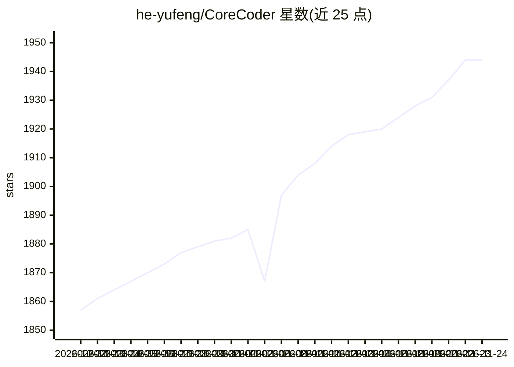

# he-yufeng/CoreCoder

⭐ 1,944 · Python · MIT · 推送 2026-11-22 · [GitHub](https://github.com/he-yufeng/CoreCoder) · [官网](https://pypi.org/project/corecoder/) · 个人维护 · 中文 README

**给学习者的最小 AI 编码 agent 引擎：可读可改可 fork**

用纯 Python 实现的最小编码 agent：核心引擎约 1,532 行（全包 3,451 行），包含主循环、流式 LLM 客户端、8 个工具（读写文件、执行 shell、子 agent 等）、三级上下文压缩、plan 模式、hooks 与 checkpoints，磁盘修改与命令执行前需用户确认。默认走 OpenAI 兼容 API，通过环境变量切换供应商，另有可选 LiteLLM 后端。定位为源码阅读参考与 fork 起点，附 8 篇双语讲解文章与 373 个离线测试；作者明确说明不面向日常生产使用。

## 筛选速览

| 维度 | 判定 | 备注 |
|---|---|---|
| AI 角色 | `ai-ecosystem` | LLM/agent 周边工具 |
| 许可风险 | `permissive` | MIT |
| 部署形态 | `library` | 以包/库形式分发 |
| 模型依赖 | local-ok | 支持本地模型 |
| 硬件要求 | — | 无带数字的原话,不猜 |
| 安装摩擦 | `low` | 无编译、无系统依赖或容器化 |
| 成熟度 | `idea` | |

## 能力要点

- 核心引擎约 1,532 行纯 Python，整个项目可一次读完
- 8 个内置工具，支持子 agent、MCP 扩展接入
- 三级上下文压缩与 OpenAI 兼容 API 多供应商切换
- 373 个离线测试与可选 live smoke test

## 适用场景

- 想通过读源码理解编码 agent 的工作原理
- 以此为基础 fork 出自己的编码 agent
- 教学场景中展示 agent 主循环与上下文管理机制

## 场景标签

`编码 Agent` `教程课程` · 领域:编码与开发

## 证据(README 行号)

> L29: The nanoGPT column is there as a reference point: minimal, readable, but it teaches you to train a GPT. CoreCoder i
> L33: I've always felt coding agents get talked about as if they were arcane. Strip a tool like Claude Code or Cursor all

## 星数曲线

2026-10-22 1,857 → 2026-11-24 1,944（+87）

---
*卡片 v1 · prompt 1.4 · 生成 2026-11-23 · 置信度 high · 依据 README sha `b352bb169b5a` · [字段定义](../../DATASET.md)*
