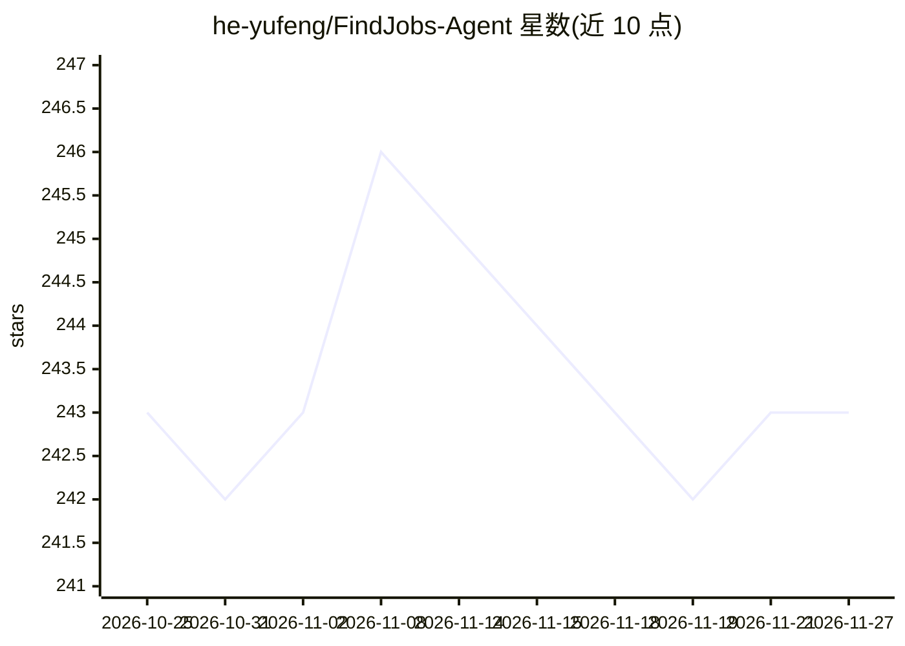

# he-yufeng/FindJobs-Agent

⭐ 243 · Python · MIT · 推送 2026-10-23 · [GitHub](https://github.com/he-yufeng/FindJobs-Agent) · 个人维护 · 中文 README

**求职者的 LLM 工具包：爬职位、析技能、改简历、AI 模拟面试**

全栈求职助手：爬取科技公司职位，LLM 提取学历/专业要求、为技能打分并归类职位体系；解析 PDF/Word 简历并计算职位匹配度；从任意职位描述生成多轮 AI 模拟面试并给出实时反馈。提供 React 前端、Flask 风格 API 服务与 SQLite 持久化，数据存 jobs.db。设置 FINDJOBS_DEMO=1 可离线跑通全流程，用确定性 stub LLM 替代付费 API key。爬虫依赖公开招聘 API；2023 年代的多个 Selenium 适配器已因验证失败从注册表移除。

## 筛选速览

| 维度 | 判定 | 备注 |
|---|---|---|
| AI 角色 | `ai-native` | 本体是模型或模型工具 |
| 许可风险 | `permissive` | MIT |
| 部署形态 | `library` | 以包/库形式分发 |
| 模型依赖 | — | README 未给出锁定关系 |
| 硬件要求 | — | 无带数字的原话,不猜 |
| 安装摩擦 | `low` | 无编译、无系统依赖或容器化 |
| 成熟度 | — | 结构信号不足 |

## 能力要点

- 爬取腾讯/字节/网易/Amazon 等职位公开 API，支持增量爬取与去重账本
- LLM 提取学历专业要求、技能评分（1–5）与职位分类
- PDF/Word 简历解析与职位-简历匹配百分比计算
- Demo 模式离线运行全流程，无需 API key

## 适用场景

- 批量抓取并结构化科技公司职位信息
- 上传简历查看与职位的技能差距和匹配度
- 针对某个职位 JD 进行多轮 AI 模拟面试并获取反馈报告

## 场景标签

`网页抓取` · 领域:效率与自动化

## 证据(README 行号)

> L12: A full-stack job search assistant that crawls postings from major tech companies, analyzes them with LLMs, parses y
> L40: - **Job crawler** — pulls postings from Tencent, NetEase, ByteDance, Amazon and more, via API or Selenium, with aut
> L43: - **AI mock interview** — generates questions from any job description and runs a multi-turn interview with real-ti

## 星数曲线

2026-10-25 243 → 2026-11-27 243（+0）

---
*卡片 v1 · prompt 1.4 · 生成 2026-11-25 · 置信度 high · 依据 README sha `34619097bda3` · [字段定义](../../DATASET.md)*
