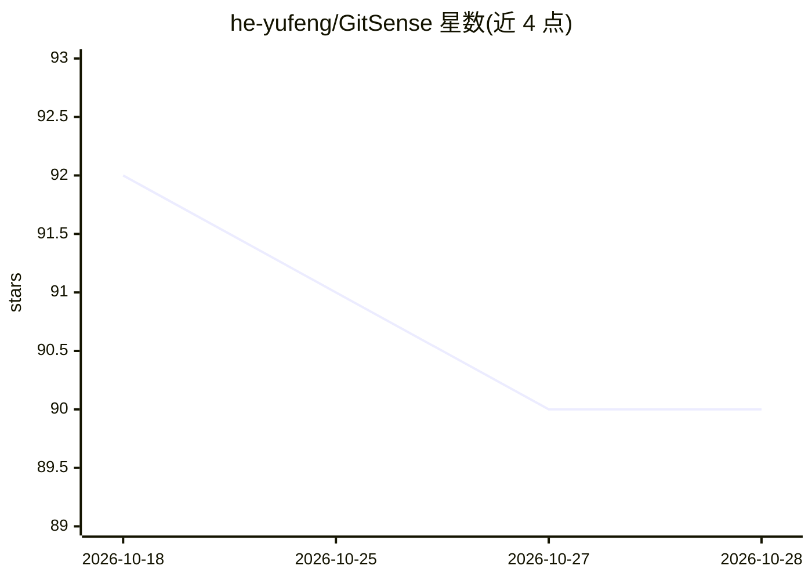

# he-yufeng/GitSense

⭐ 90 · Python · MIT · 推送 2026-10-23 · [GitHub](https://github.com/he-yufeng/GitSense) · 个人维护 · 中文 README

**帮开发者按技能匹配可做的开源 issue 并评估仓库健康度的 CLI**

GitSense 是一个 Python CLI（pip 安装）：根据用户声明的技能构建 GitHub 搜索查询，抓取未分配的开放 issue，去重过滤后用 OpenAI 兼容 API 的 LLM 对每个 issue 做 1-10 分技能匹配评分并给出入手提示；无 API key 时回退到免费的关键词确定性排序。Radar 模式基于公开 PR 历史信号（合并速度、维护者响应时间、stale PR 比例、外部贡献者合并率等）给仓库打分，另有 predict/triage 子命令对 PR 做启发式评分与行动归类。面向想参与开源贡献的开发者。

## 筛选速览

| 维度 | 判定 | 备注 |
|---|---|---|
| AI 角色 | `ai-enhanced` | 去掉 AI 部分产品仍成立 |
| 许可风险 | `permissive` | MIT |
| 部署形态 | `library` | 以包/库形式分发 |
| 模型依赖 | — | README 未给出锁定关系 |
| 硬件要求 | — | 无带数字的原话,不猜 |
| 安装摩擦 | `medium` | 含编译或系统依赖之一 |
| 成熟度 | — | 结构信号不足 |

## 能力要点

- LLM 对候选 issue 做 1-10 分技能匹配评分并给出修复入手提示
- 无 API key 时回退到免费确定性关键词排序（--no-llm）
- Radar 模式从公开 PR 信号给仓库健康度评分
- triage 子命令用批量 GraphQL 查询对全部开放 PR 归类下一步行动

## 适用场景

- 我想找适合自己技能水平、还没被认领的开源 issue
- 投 PR 前先看看这个仓库维护者响应和合并习惯如何
- 把我名下多个开放 PR 快速整理成各自该做的下一步

## 场景标签

 · 领域:开发者工具/开源贡献发现

## 证据(README 行号)

> L16: **GitSense** does the searching for you. It queries GitHub for open, unassigned issues across thousands of repos, t

## 星数曲线

2026-10-18 92 → 2026-10-28 90（-2）

---
*卡片 v1 · prompt 1.4 · 生成 2026-10-23 · 置信度 high · 依据 README sha `be6d10b2a066` · [字段定义](../../DATASET.md)*
