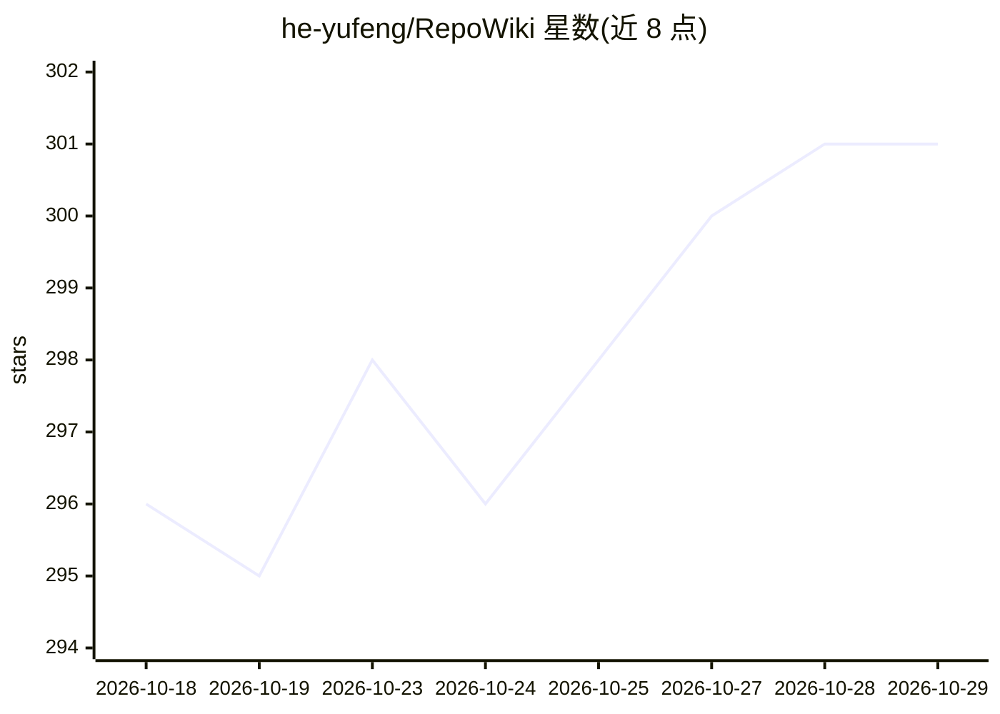

# he-yufeng/RepoWiki

⭐ 301 · Python · MIT · 推送 2026-10-23 · [GitHub](https://github.com/he-yufeng/RepoWiki) · [官网](https://pypi.org/project/repowiki/) · 个人维护 · 中文 README

**为任意代码库生成结构化 Wiki 文档的 CLI/Web 工具**

面向开发者与代码阅读者的文档生成工具：扫描代码库，解析 6 种语言的 import 构建依赖图并以 PageRank 排序文件重要性，经 4 轮 LLM 结构化分析生成项目概览、模块文档、架构 Mermaid 图与阅读路径，输出 Markdown/JSON/HTML 三种格式。支持增量重扫与 SQLite 内容缓存以减少 API 调用。附带三栏 Web 查看器与终端多轮问答（repowiki chat），答案附文件级行号来源。模型接入依赖 litellm 的 100+ 提供商，需自备 API key。

## 筛选速览

| 维度 | 判定 | 备注 |
|---|---|---|
| AI 角色 | `ai-native` | 本体是模型或模型工具 |
| 许可风险 | `permissive` | MIT |
| 部署形态 | `self-host` | docker 或自建部署 |
| 模型依赖 | locked-api |  |
| 硬件要求 | — | 无带数字的原话,不猜 |
| 安装摩擦 | `low` | 无编译、无系统依赖或容器化 |
| 成熟度 | — | 结构信号不足 |

## 能力要点

- PageRank 文件重要性排序与引导式阅读路径
- 增量重扫 + 内容哈希 SQLite 缓存，未变更模块跳过 LLM 调用
- 终端/网页多轮问答，回答附 file:start-end 行级来源
- diff 排序：按重要性与影响面为代码审查排列文件顺序

## 适用场景

- 接手陌生代码库时快速生成导览文档确定阅读入口
- 为团队仓库维护可提交到 GitHub Pages 的 Wiki 站点
- 代码评审时按文件重要性排列 diff 的审查顺序
- 在终端对代码库做带来源引用的问答

## 场景标签

`AI 写作` `文档问答` · 领域:内容生成

## 证据(README 行号)

> L10: **Open-source DeepWiki alternative** — generate comprehensive wiki documentation for any codebase from your termina
> L100: 3. **Analyze** — Send file tree + key files to LLM in 4 structured passes (overview, modules, architecture, readin

## 星数曲线

2026-10-18 296 → 2026-10-29 301（+5）

---
*卡片 v1 · prompt 1.4 · 生成 2026-10-22 · 置信度 mid · 依据 README sha `45d76bd6b9c3` · [字段定义](../../DATASET.md)*
