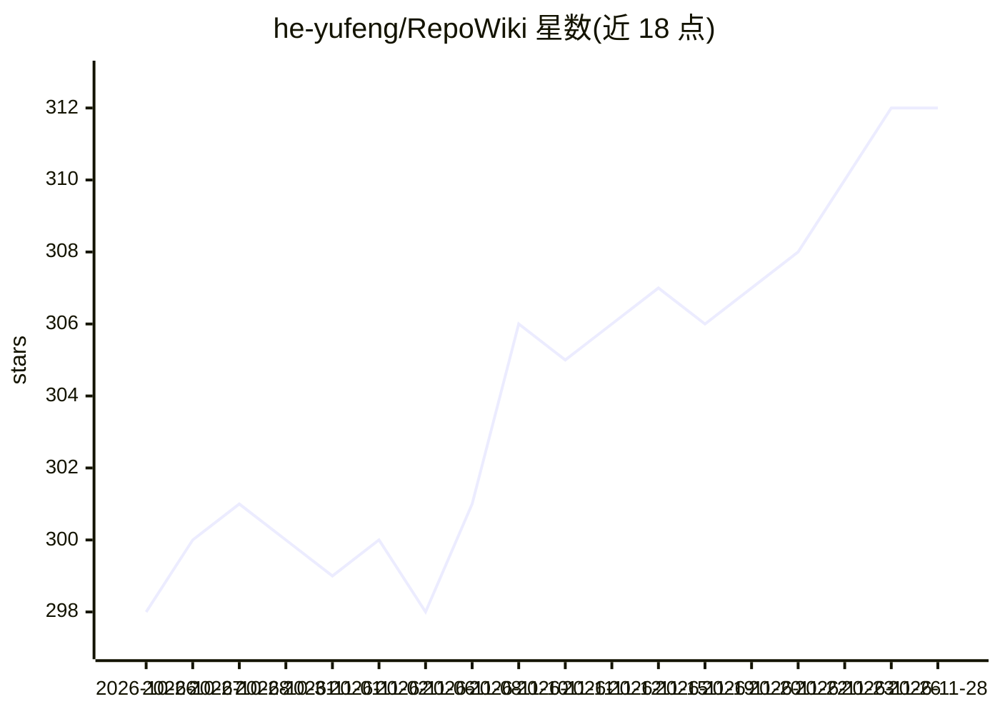

# he-yufeng/RepoWiki

⭐ 312 · Python · MIT · 推送 2026-11-27 · [GitHub](https://github.com/he-yufeng/RepoWiki) · [官网](https://pypi.org/project/repowiki/) · 个人维护 · 中文 README

**开发者用 LLM 从任意代码库生成 wiki 文档的 CLI/浏览器工具**

以 pip 安装的 CLI 工具，扫描本地或 URL 代码库后经 LLM 四阶段分析生成结构化 wiki：项目总览、模块文档、Mermaid 架构图、PageRank 阅读路径与符号索引。输出 Markdown/JSON/自包含 HTML，可经 docsify 直接发布到 GitHub Pages。依赖 Python 与 SQLite，无需 Docker 与数据库服务；带内容哈希 SQLite 缓存做增量重建，未变更模块跳过 LLM 调用；另有 `repowiki chat` 终端问答，每条回答附行级来源，检索用内置 TF-IDF 索引而非嵌入服务。

## 筛选速览

| 维度 | 判定 | 备注 |
|---|---|---|
| AI 角色 | `ai-native` | 本体是模型或模型工具 |
| 许可风险 | `permissive` | MIT |
| 部署形态 | `self-host` | docker 或自建部署 |
| 模型依赖 | locked-api |  |
| 硬件要求 | — | 无带数字的原话,不猜 |
| 安装摩擦 | `low` | 无编译、无系统依赖或容器化 |
| 成熟度 | — | 结构信号不足 |

## 能力要点

- CLI-first：`pip install repowiki` 即可，无需 Docker、数据库服务或浏览器
- PageRank 文件重要性排序与 diff 审查顺序（`repowiki diff`）
- SQLite 内容哈希缓存实现增量重建，未变更页面不触发 LLM 调用
- 终端/网页问答答案附 `file:start-end` 行级来源；TF-IDF 索引无嵌入服务依赖

## 适用场景

- 为接手或 review 的代码库快速生成带阅读路径的 wiki
- 按重要性排序查看一次 PR 改动该先读哪些文件
- 在终端就代码库提问并获得带行号来源的回答
- 把生成的 wiki 静态站点发布到 GitHub Pages 供团队阅读

## 场景标签

`知识库管理` `AI 写作` · 领域:内容生成

## 证据(README 行号)

> L10: **Open-source DeepWiki alternative** — generate comprehensive wiki documentation for any codebase from your termina
> L100: 3. **Analyze** — Send file tree + key files to LLM in 4 structured passes (overview, modules, architecture, readin
> L53: - **Web viewer + terminal chat**: a three-column browser UI, or `repowiki chat .` for grounded Q&A in the terminal.

## 星数曲线

2026-10-26 298 → 2026-11-28 312（+14）

---
*卡片 v1 · prompt 1.4 · 生成 2026-11-28 · 置信度 mid · 依据 README sha `1cd60c82da82` · [字段定义](../../DATASET.md)*
