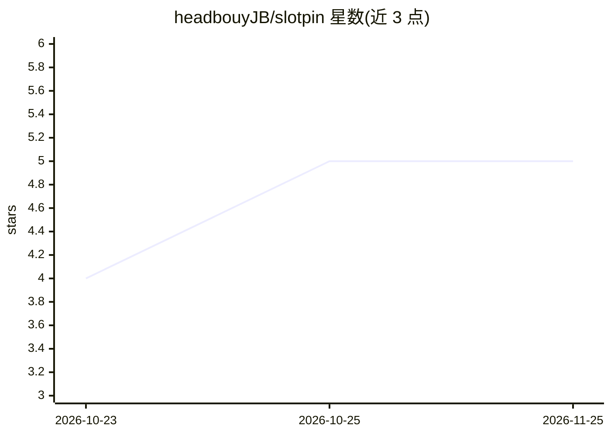

# headbouyJB/slotpin

⭐ 5 · Python · MIT · 推送 2026-10-18 · [GitHub](https://github.com/headbouyJB/slotpin) · 个人维护

**本地 LLM 服务器的槽位固定缓存感知反代与仪表盘**

面向 llama.cpp 的 llama-server 或 Gufo 引擎的反向代理，加只读仪表盘。按请求正则分类到冷热通道，通过设置 id_slot 将会话固定到已持有其 KV 缓存的槽位，支持 KV 快照落盘恢复与最长前缀恢复；带分级优先调度（老化防饿死）、静默上游快速失败（504）与逐轮指标流（TTFT、速度、缓存行为、内存，可接智能插头测能耗），不含提示词与回复文本。仅标准库实现，完整栈需 Linux 与 systemd。

## 筛选速览

| 维度 | 判定 | 备注 |
|---|---|---|
| AI 角色 | `ai-ecosystem` | LLM/agent 周边工具 |
| 许可风险 | `permissive` | MIT |
| 部署形态 | `library` | 以包/库形式分发 |
| 模型依赖 | local-ok | 支持本地模型 |
| 硬件要求 | — | 无带数字的原话,不猜 |
| 安装摩擦 | `low` | 无编译、无系统依赖或容器化 |
| 成熟度 | `idea` | |

## 能力要点

- 槽位固定与 KV 快照保存/恢复、最长前缀恢复
- 冷热通道分类与带老化的优先级调度、队列上限与负载丢弃
- 逐轮 JSON 指标（TTFT、解码/预填充速度、内存、可选能耗），不记录提示词文本
- 只读仪表盘支持 1 小时至 7 天历史，可被 Prometheus/Grafana 抓取

## 适用场景

- 本地自托管 llama-server 时减少交互会话的冷预填充等待
- 为多用户共享本地 LLM 服务做会话亲和与调度
- 用 Grafana 监控本地推理的延迟、缓存命中与能耗

## 场景标签

`推理引擎` · 领域:训练与推理

## 证据(README 行号)

> L3: `slotpin` is a slot-pinning, cache-aware reverse proxy for a local LLM inference server (llama.cpp's `llama-server`,
> L11: - **Slot pinning.** Sets `id_slot` on each request so a conversation lands in the KV slot that already holds it.
> L24: - An inference server: `llama-server` started with `--slot-save-path` (for KV save/restore), `-np N` equal to `slot

## 星数曲线

2026-10-23 4 → 2026-11-25 5（+1）

---
*卡片 v1 · prompt 1.4 · 生成 2026-11-21 · 置信度 high · 依据 README sha `18737166b144` · [字段定义](../../DATASET.md)*
