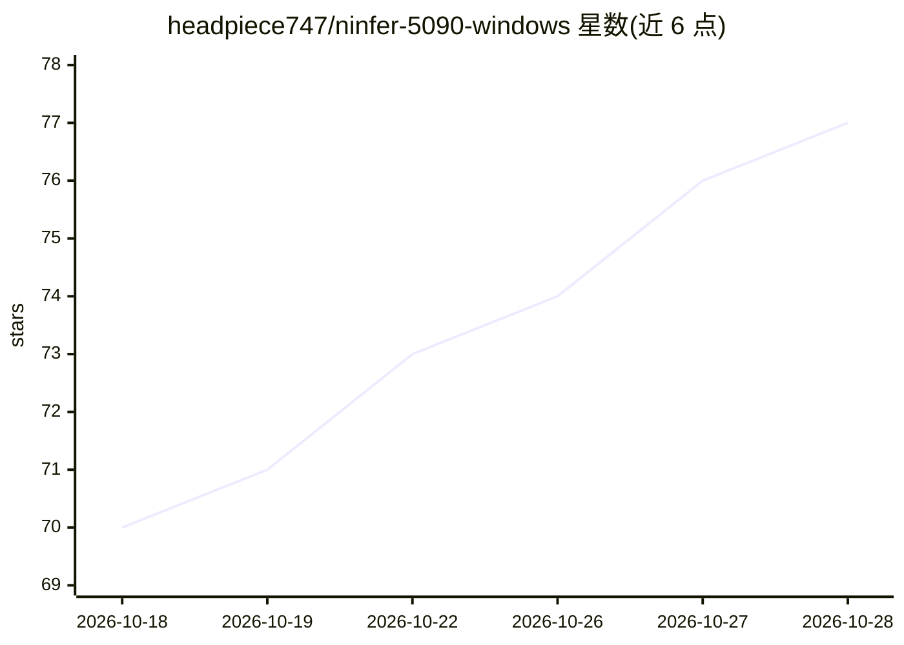

# headpiece747/ninfer-5090-windows

⭐ 77 · C++ · Apache-2.0 · 推送 2026-10-26 · [GitHub](https://github.com/headpiece747/ninfer-5090-windows) · 个人维护

**NInfer 推理引擎的 Windows 原生移植版，面向 RTX 5090**

将 Neroued/ninfer 的 C++/CUDA 引擎用 MSVC 与 CUDA 13.3 在 Windows 11 x64 上原生构建，不依赖 WSL2 或 Docker。面向 RTX 5090 单卡场景，提供本地 CLI 及 OpenAI/Anthropic 兼容 HTTP API，支持文本、图像、视频输入，262,144 token 上下文，随附 8 个基于 Qwen3.8-27B 五条 nvfp4 量化产物线的启动器，采用 DFlash2/MTP 投机解码与资源感知的长上下文 KV 复用。以发布包（含下载模型的 bat 脚本）安装，也可从源码构建；引擎拒绝 v2 产物，需 v3。

## 筛选速览

| 维度 | 判定 | 备注 |
|---|---|---|
| AI 角色 | `ai-ecosystem` | LLM/agent 周边工具 |
| 许可风险 | `permissive` | Apache-2.0 |
| 部署形态 | `desktop` | 安装包/桌面程序 |
| 模型依赖 | — | README 未给出锁定关系 |
| 硬件要求 | — | 无带数字的原话,不猜 |
| 安装摩擦 | `high` | 编译与系统依赖俱全 |
| 成熟度 | — | 结构信号不足 |

## 能力要点

- 8 个 Qwen3.8-27B 启动器，覆盖 262,144 token 上下文与视觉能力
- DFlash2/MTP 投机解码，单卡实测解码 173-366 tok/s
- OpenAI/Anthropic 兼容 HTTP API 与本地 CLI
- 资源感知长上下文复用（Device/Host KV 检查点与驱逐规划）

## 适用场景

- 在 RTX 5090 上本地运行 Qwen3.8-27B 长上下文推理服务
- 通过 OpenAI/Anthropic 兼容 API 接入现有客户端
- 对比 DFlash2 与 MTP 投机解码路线的吞吐表现

## 场景标签

`推理引擎` `模型量化` · 领域:训练与推理

## 证据(README 行号)

> L5: This repository is the native Windows port of Neroued/ninfer:
> L7: Docker. It runs text, image, and video prompts through a local CLI or OpenAI-/Anthropic-compatible

## 星数曲线

2026-10-18 70 → 2026-10-28 77（+7）

---
*卡片 v1 · prompt 1.4 · 生成 2026-10-24 · 置信度 high · 依据 README sha `118a8891d43d` · [字段定义](../../DATASET.md)*
