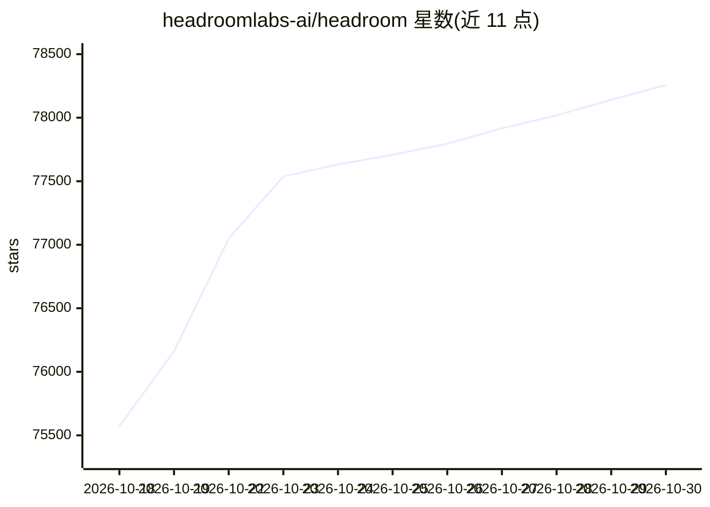

# headroomlabs-ai/headroom

⭐ 78,256 · Python · Apache-2.0 · 推送 2026-10-29 · [GitHub](https://github.com/headroomlabs-ai/headroom) · [官网](https://docs.headroomlabs.ai/docs) · 组织维护

**为 AI agent 压缩上下文输入输出的本地压缩层**

在工具输出、日志、RAG 片段、文件与对话历史进入 LLM 前进行压缩，以 Python/TypeScript 库、本地代理、agent 包装命令和 MCP server 四种形式提供。内部按内容类型路由到不同压缩器（JSON/代码/文本），原文本地缓存并可通过 headroom_retrieve 按需取回。还提供输出 token 削减（verbosity steering、effort routing）与跨 agent 共享记忆。压缩在本地运行，不外发内容。

## 筛选速览

| 维度 | 判定 | 备注 |
|---|---|---|
| AI 角色 | `ai-native` | 本体是模型或模型工具 |
| 许可风险 | `permissive` | Apache-2.0 |
| 部署形态 | `self-host` | docker 或自建部署 |
| 模型依赖 | locked-api |  |
| 硬件要求 | — | 无带数字的原话,不猜 |
| 安装摩擦 | `low` | 无编译、无系统依赖或容器化 |
| 成熟度 | — | 结构信号不足 |

## 动量与使用信号

- 维护:`active` — 距上次 push 1.1 天,年发版 100,332 位贡献者
- 涨星:近 1 天 **+103**(自 20261016 起算)
- 安装:pypi 包 `headroom-ai` 月下载 292,636
- 平台:— · 协议:OPENAI-API / MCP

## 能力要点

- 库、代理、wrap 命令、MCP server 四种接入方式
- CCR 机制本地缓存原文，可按需取回
- 支持 20 余种 agent CLI 的一键包装与还原
- 输出 token 削减开关与 savings/评估命令

## 适用场景

- 给 coding agent 降低工具输出与日志的 token 消耗
- 为 RAG 管道压缩检索片段
- 团队统一管理多个 agent CLI 的上下文成本

## 场景标签

`Agent 记忆` · 领域:Agent 开发

## 证据(README 行号)

> L26: Headroom compresses everything your AI agent reads — tool outputs, logs, RAG
> L38: - **Library** — `compress(messages)` in Python or TypeScript, inline in any app.
> L41: - **MCP server** — `headroom_compress`, `headroom_retrieve`, `headroom_stats` for any MCP client.

## 星数曲线

2026-10-18 75,573 → 2026-10-30 78,256（+2,683）

---
*卡片 v1 · prompt 1.4 · 生成 2026-10-18 · 置信度 mid · 依据 README sha `70ed6d23b8ef` · [字段定义](../../DATASET.md)*
