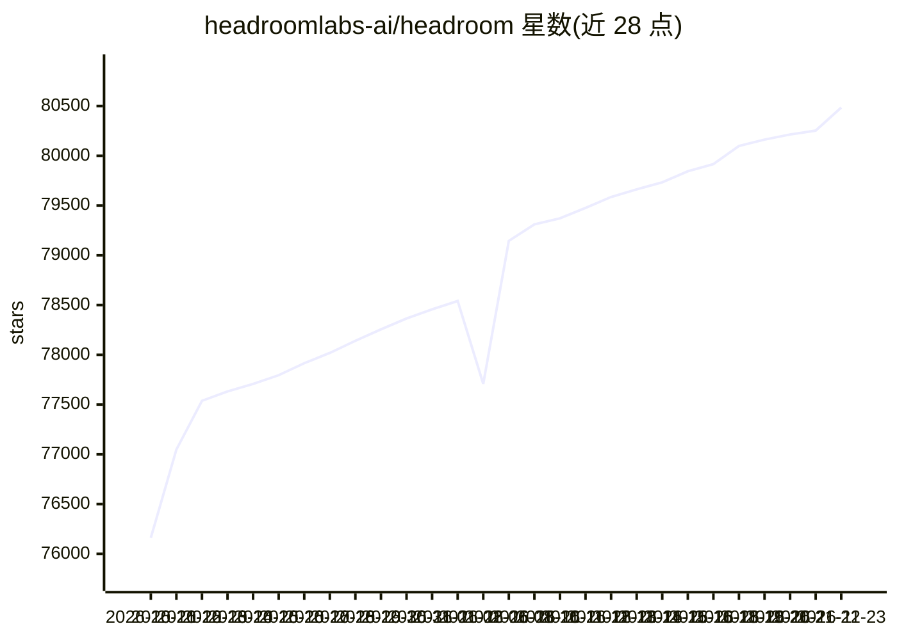

# headroomlabs-ai/headroom

⭐ 80,485 · Python · Apache-2.0 · 推送 2026-11-22 · [GitHub](https://github.com/headroomlabs-ai/headroom) · [官网](https://docs.headroomlabs.ai/docs) · 组织维护

**为 AI agent 压缩工具输出/日志/RAG 内容以减少输入 token 的层**

Headroom 以库、本地代理与 MCP server 三种形态交付：在内容到达 LLM 前检测类型并选择压缩器（JSON、代码、文本各有专用压缩路径），原始内容本地缓存、可按需检索还原。支持 Python/TypeScript SDK、FastAPI 集成、`headroom wrap` 一条命令包装 Claude Code 等编码 agent，以及跨 agent 共享记忆与输出侧精简。压缩在本地运行，不联网；README 附带基准与评测数据，并注明对散文类内容压缩效果有限。

## 筛选速览

| 维度 | 判定 | 备注 |
|---|---|---|
| AI 角色 | `ai-ecosystem` | LLM/agent 周边工具 |
| 许可风险 | `permissive` | Apache-2.0 |
| 部署形态 | `self-host` | docker 或自建部署 |
| 模型依赖 | — | README 未给出锁定关系 |
| 硬件要求 | — | 无带数字的原话,不猜 |
| 安装摩擦 | `low` | 无编译、无系统依赖或容器化 |
| 成熟度 | — | 结构信号不足 |

## 动量与使用信号

- 维护:`active` — 距上次 push 1.1 天,年发版 100,332 位贡献者
- 涨星:近 1 天 **+103**(自 20261016 起算)
- 安装:pypi 包 `headroom-ai` 月下载 292,636
- 平台:— · 协议:OPENAI-API / MCP

## 能力要点

- 库/代理/MCP server 三种接入形态，代理模式零代码改动
- ContentRouter 按内容类型分发到 JSON/代码/文本专用压缩器
- CCR 机制本地缓存原文，模型可按需 retrieve 还原
- 提供 4 个 agent 场景的 token 节省基准与 4 项评测基准

## 适用场景

- 编码 agent 读取大量工具输出时降低输入 token 成本
- 应用内联压缩对话历史与 RAG 检索片段
- SRE 日志排障场景压缩重复日志行
- 团队复用 GitHub Copilot CLI 订阅流量走本地代理

## 场景标签

 · 领域:LLM 基础设施/上下文工程

## 证据(README 行号)

> L26: **Headroom** (`headroom-ai` on PyPI and npm) compresses everything your AI agent
> L74: - **Library** — `compress(messages)` in Python or TypeScript, inline in any app.
> L75: - **Proxy** — `headroom proxy --port 8787`, zero code changes, any language.
> L77: - **MCP server** — `headroom_compress`, `headroom_retrieve`, `headroom_stats` for any MCP client.

## 星数曲线

2026-10-21 76,161 → 2026-11-23 80,485（+4,324）

---
*卡片 v1 · prompt 1.4 · 生成 2026-11-22 · 置信度 mid · 依据 README sha `6307f3fa1d39` · [字段定义](../../DATASET.md)*
