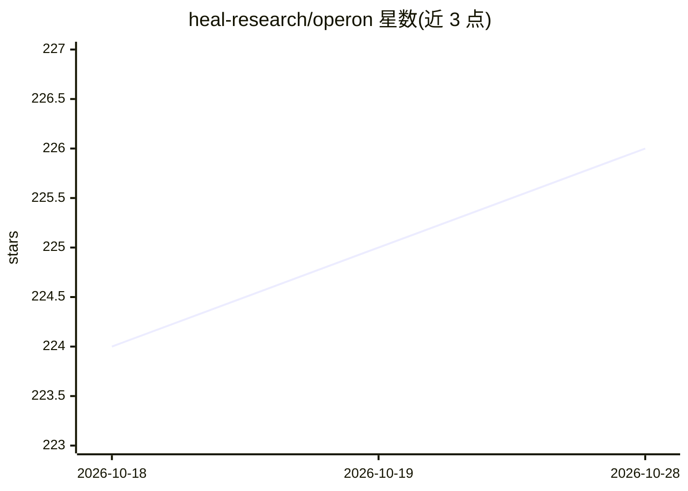

# heal-research/operon

⭐ 226 · C++ · MIT · 推送 2026-10-28 · [GitHub](https://github.com/heal-research/operon) · [官网](https://operongp.readthedocs.io) · 组织维护

**C++ 符号回归框架：用遗传编程拟合可解释数学模型**

基于 C++ 的符号回归框架，通过遗传编程演化表达式树，在候选数学表达式空间中搜索对给定回归目标拟合最佳的模型，面向系统辨识领域构建精确且可解释的白盒模型。构建依赖 CMake 与支持 C++23 的编译器，推荐通过 nix 或 vcpkg 构建；Python 绑接以独立项目 PyOperon 提供，其中含 scikit-learn 兼容的回归器。项目有 ACM 论文发表记录，并提供详细构建文档。

## 筛选速览

| 维度 | 判定 | 备注 |
|---|---|---|
| AI 角色 | `ai-native` | 本体是模型或模型工具 |
| 许可风险 | `permissive` | MIT |
| 部署形态 | `None` |  |
| 模型依赖 | — | README 未给出锁定关系 |
| 硬件要求 | — | 无带数字的原话,不猜 |
| 安装摩擦 | `medium` | 含编译或系统依赖之一 |
| 成熟度 | — | 结构信号不足 |

## 能力要点

- 遗传编程演化表达式树执行符号回归
- 输出可解释的白盒数学表达式模型
- 提供 nix 与 vcpkg 两种推荐构建方式
- 独立项目 PyOperon 提供 Python 绑定与 scikit-learn 兼容回归器

## 适用场景

- 为回归任务寻找可解释的数学表达式模型
- 系统辨识领域构建白盒模型
- 通过 Python/scikit-learn 接口使用符号回归

## 场景标签

 · 领域:机器学习/符号回归

## 证据(README 行号)

> L10: *Operon* is a modern C++ framework for symbolic regression that uses genetic programming to explore a hypothesis sp
> L11: Its main purpose is to help develop accurate and interpretable white-box models in the area of system identificatio

## 星数曲线

2026-10-18 224 → 2026-10-28 226（+2）

---
*卡片 v1 · prompt 1.4 · 生成 2026-10-22 · 置信度 high · 依据 README sha `0db447839620` · [字段定义](../../DATASET.md)*
