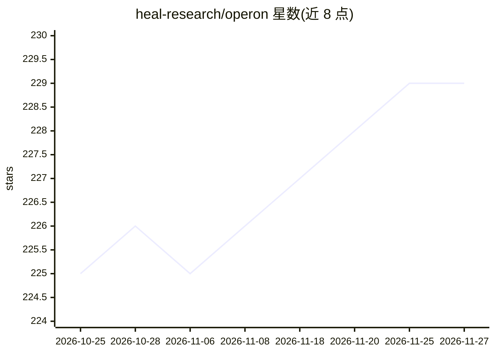

# heal-research/operon

⭐ 229 · C++ · MIT · 推送 2026-11-26 · [GitHub](https://github.com/heal-research/operon) · [官网](https://operongp.readthedocs.io) · 组织维护

**C++ 符号回归框架：用遗传编程搜索数学表达式模型**

Operon 是一个 C++ 符号回归框架，以遗传编程演化表达式树种群，在系统辨识领域寻找拟合目标变量的可解释白盒模型。需 CMake 与支持 C++23 的编译器，推荐通过 nix 或 vcpkg 构建；提供 operon_gp / operon_nsgp 两个命令行引擎，支持 --print-config 输出含算子参数、数据集 SHA-256、种子等信息的 JSON 解析配置以便复现。Python 绑定以独立项目 PyOperon 发布，含 scikit-learn 兼容回归器。

## 筛选速览

| 维度 | 判定 | 备注 |
|---|---|---|
| AI 角色 | `ai-native` | 本体是模型或模型工具 |
| 许可风险 | `permissive` | MIT |
| 部署形态 | `None` |  |
| 模型依赖 | — | README 未给出锁定关系 |
| 硬件要求 | — | 无带数字的原话,不猜 |
| 安装摩擦 | `medium` | 含编译或系统依赖之一 |
| 成熟度 | — | 结构信号不足 |

## 能力要点

- 遗传编程演化表达式树进行符号回归
- CLI 支持 --print-config/--config-out 输出解析配置并校验设置
- 提供含数据集 SHA-256、种子与线程溯源的可复现运行配置
- Python 绑定 PyOperon 提供 scikit-learn 兼容回归器

## 适用场景

- 对观测数据做符号回归，寻找可解释的数学表达式模型
- 系统辨识中开发白盒模型
- 需要显式种子与配置快照的可复现实验

## 场景标签

`数据分析` `科研工具` · 领域:效率与自动化

## 证据(README 行号)

> L10: *Operon* is a modern C++ framework for symbolic regression that uses genetic programming to explore a hypothesis sp
> L21: The project requires CMake and a compiler supporting C++23. The recommended way to build Operon is via either nix o

## 星数曲线

2026-10-25 225 → 2026-11-27 229（+4）

---
*卡片 v1 · prompt 1.4 · 生成 2026-11-26 · 置信度 high · 依据 README sha `062aaa0c284e` · [字段定义](../../DATASET.md)*
