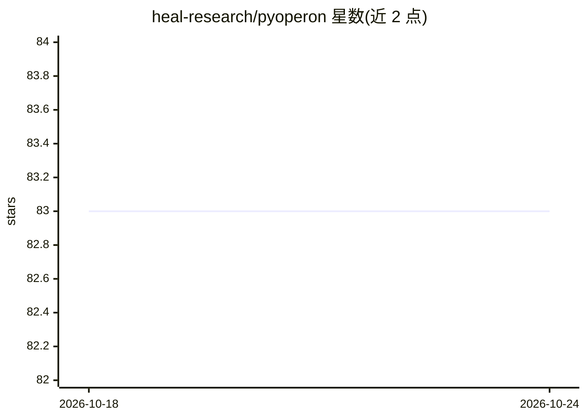

# heal-research/pyoperon

⭐ 83 · Python · MIT · 推送 2026-10-23 · [GitHub](https://github.com/heal-research/pyoperon) · 组织维护

**符号回归 C++ 框架 Operon 的 Python 绑定与 sklearn 接口**

Operon 是 Heal-Research（奥地利上奥地利应用科学大学）开发的 C++ 符号回归框架，pyoperon 为其提供 Python 绑定，并附带 scikit-learn 兼容的 SymbolicRegressor，可直接 fit/predict。支持 Keras/Lightning 风格的 callbacks 监控与早停（可子类化 pyoperon.Callback 自定义），fit() 支持 sample_weight 参数处理非均匀采样数据。面向使用 Python 生态做符号回归/遗传编程的机器学习开发者；限制是依赖 C++ 后端，从源码构建需 Conda/Mamba 或 Nix 环境。

## 筛选速览

| 维度 | 判定 | 备注 |
|---|---|---|
| AI 角色 | `ai-native` | 本体是模型或模型工具 |
| 许可风险 | `permissive` | MIT |
| 部署形态 | `library` | 以包/库形式分发 |
| 模型依赖 | — | README 未给出锁定关系 |
| 硬件要求 | — | 无带数字的原话,不猜 |
| 安装摩擦 | `low` | 无编译、无系统依赖或容器化 |
| 成熟度 | — | 结构信号不足 |

## 能力要点

- scikit-learn 兼容的 SymbolicRegressor 接口
- callbacks 监控与早停机制（on_generation_end 返回 True 终止训练）
- fit() 支持 sample_weight 非均匀样本加权
- 提供 Conda/Mamba 与 Nix 两种源码构建路径

## 适用场景

- 在 scikit-learn 流水线中做符号回归建模
- 对调查数据等非均匀样本做加权符号回归训练
- 通过自定义回调监控训练过程并早停

## 场景标签

 · 领域:机器学习/符号回归

## 证据(README 行号)

> L8: **pyoperon** is the python bindings library of **Operon**, a modern C++ framework for symbolic regression developed 
> L12: from pyoperon.sklearn import SymbolicRegressor

## 星数曲线

2026-10-18 83 → 2026-10-24 83（+0）

---
*卡片 v1 · prompt 1.4 · 生成 2026-10-24 · 置信度 high · 依据 README sha `82cf3e97367c` · [字段定义](../../DATASET.md)*
