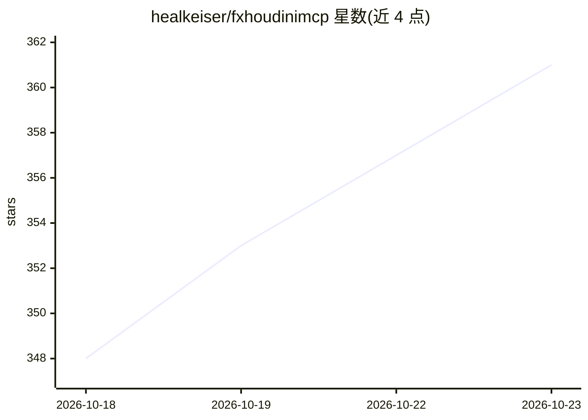

# healkeiser/fxhoudinimcp

⭐ 361 · Python · MIT · 推送 2026-10-20 · [GitHub](https://github.com/healkeiser/fxhoudinimcp) · [官网](https://healkeiser.github.io/fxhoudinimcp/) · 个人维护

**让 AI 客户端通过 MCP 操作 SideFX Houdini 的服务器**

面向 SideFX Houdini 的 MCP 服务器，分两部分：随 Houdini 启动的插件（基于 hwebserver，经 hdefereval 在主线程执行 hou.* 调用）与独立进程的 MCP 服务器，通过回环 HTTP 中继工具调用。提供 215 个工具、8 个资源与 9 个提示词，覆盖网络构建、Pyro/RBD/FLIP/Vellum 一键设置、USD 检查、渲染、PDG 烹饪等 31 类工作流，兼容 Claude、Codex、Copilot、Cursor、VS Code 等任意 MCP 客户端。要求 Houdini 20.5+ 与 Python 3.10+。限制：无认证与按工具权限，execute_python 运行任意代码，面向单艺术家工作站场景。

## 筛选速览

| 维度 | 判定 | 备注 |
|---|---|---|
| AI 角色 | `ai-ecosystem` | LLM/agent 周边工具 |
| 许可风险 | `permissive` | MIT |
| 部署形态 | `library` | 以包/库形式分发 |
| 模型依赖 | — | README 未给出锁定关系 |
| 硬件要求 | — | 无带数字的原话,不猜 |
| 安装摩擦 | `low` | 无编译、无系统依赖或容器化 |
| 成熟度 | — | 结构信号不足 |

## 能力要点

- 215 个工具覆盖 SOP/DOP/LOPs/PDG/渲染/HDA 等 Houdini 全模块
- python -m fxhoudinimcp install 一键注册 Houdini 插件与所有检测到的 MCP 客户端
- 每次工具调用对应一个撤销步骤，保留用户选择与视口状态
- 31 篇随附工作流指南与 Pyro/RBD/FLIP/Vellum 一键设置工具

## 适用场景

- 用对话指令在 Houdini 中搭建节点网络与模拟
- 让 AI 助手检查、调试场景烹饪错误
- 通过 AI 客户端启动渲染、写缓存与 USD 场景构建

## 场景标签

 · 领域:3D/视觉特效工具

## 证据(README 行号)

> L23: An MCP server for SideFX Houdini: it lets an AI assistant build networks, set up simulations, inspect USD stages an
> L61: The plugin runs on Houdini's built-in `hwebserver` and executes every `hou.*` call on the main thread through `hdef

## 星数曲线

2026-10-18 348 → 2026-10-23 361（+13）

---
*卡片 v1 · prompt 1.4 · 生成 2026-10-21 · 置信度 high · 依据 README sha `4579fc29796a` · [字段定义](../../DATASET.md)*
