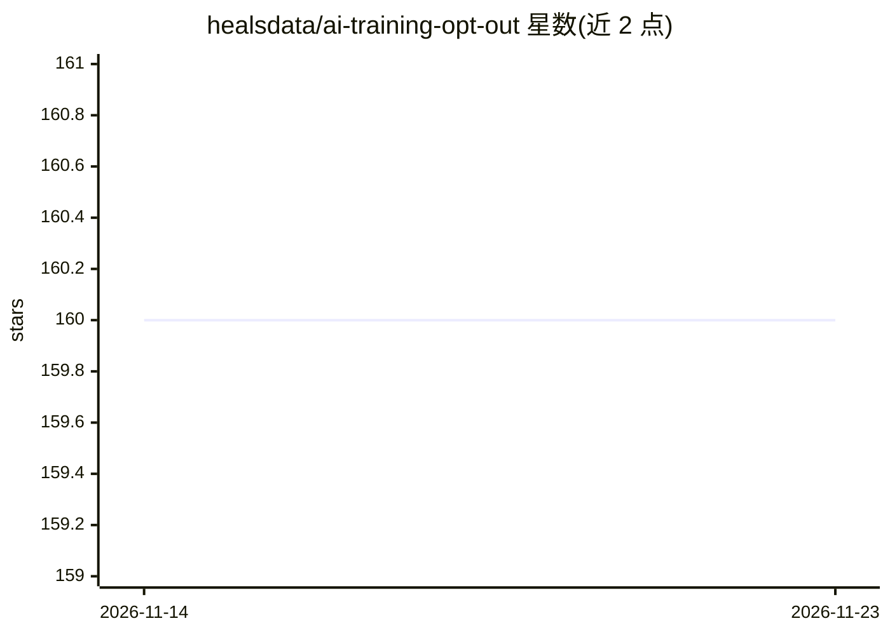

# healsdata/ai-training-opt-out

⭐ 160 · HTML · Unlicense · 推送 2026-11-14 · [GitHub](https://github.com/healsdata/ai-training-opt-out) · 个人维护

**拒绝内容被用于 AI 训练的标签与设置清单**

汇编各平台与 AI 厂商的训练退出（opt-out）方法的策展清单：涵盖 robots.txt 标签、平台设置路径（如 OpenAI ChatGPT 的 Data controls 开关、Substack 出版物设置）、haveibeentrained.com 与 The Stack 数据集退出渠道等，并附参考链接与外部清单（Dark Visitors、TDMRep、Privacy Toggles）。内容为文档形式，无安装或运行组件，面向希望限制自有内容被 AI 训练使用的个人与发布者。

## 筛选速览

| 维度 | 判定 | 备注 |
|---|---|---|
| AI 角色 | `ai-knowledge` | 知识聚合/清单类 |
| 许可风险 | `permissive` | Unlicense |
| 部署形态 | `None` |  |
| 模型依赖 | — | README 未给出锁定关系 |
| 硬件要求 | — | 无带数字的原话,不猜 |
| 安装摩擦 | `low` | 无编译、无系统依赖或容器化 |
| 成熟度 | — | 结构信号不足 |

## 能力要点

- 汇总 robots.txt 与各平台 AI 训练退出标签/设置
- 覆盖 OpenAI/StabilityAI/AWS/Substack/WordPress 等多平台退出路径
- 附 TDMRep、Dark Visitors 等参考资源

## 适用场景

- 查找自己所用服务的 AI 训练退出开关
- 为个人网站配置 robots.txt 拒绝爬虫
- 从 The Stack 等数据集申请移除自己的代码

## 场景标签

`精选清单` · 领域:学习与行业

## 证据(README 行号)

> L1: # AI Training Opt Out
> L2: Known tags and settings suggested to opt out of having your content used for AI training.

## 星数曲线

2026-11-14 160 → 2026-11-23 160（+0）

---
*卡片 v1 · prompt 1.4 · 生成 2026-11-17 · 置信度 high · 依据 README sha `a4b7f26a101c` · [字段定义](../../DATASET.md)*
