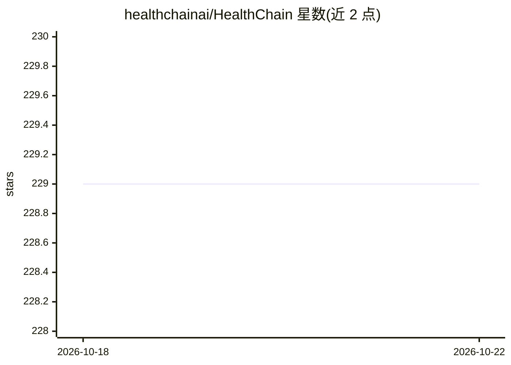

# healthchainai/HealthChain

⭐ 229 · Python · Apache-2.0 · 推送 2026-10-19 · [GitHub](https://github.com/healthchainai/HealthChain) · [官网](https://healthchainai.github.io/HealthChain/) · 组织维护

**面向医疗 AI 的 Python SDK：连接真实 FHIR API 并构建校验 FHIR 输出**

为医疗数据与 AI 团队提供的 Python SDK，围绕 FHIR 数据边界构建：通过 FHIRGateway 统一接入 Epic、Cerner、Medplum 等 FHIR R4 服务器，处理认证与路由；提供扁平类型化辅助方法构建 FHIR 资源，经 validate_resource 输出结构化校验报告；同一套构建、校验、读取、术语操作工具可经 MCP 或 LangChain 暴露给 agent；结果可经 FHIR REST、CDS Hooks、SOAP/CDA 等方式交付。由 dotimplement ai 维护，CLI 支持脚手架与服务运行。

## 筛选速览

| 维度 | 判定 | 备注 |
|---|---|---|
| AI 角色 | `ai-ecosystem` | LLM/agent 周边工具 |
| 许可风险 | `permissive` | Apache-2.0 |
| 部署形态 | `library` | 以包/库形式分发 |
| 模型依赖 | — | README 未给出锁定关系 |
| 硬件要求 | — | 无带数字的原话,不猜 |
| 安装摩擦 | `low` | 无编译、无系统依赖或容器化 |
| 成熟度 | — | 结构信号不足 |

## 能力要点

- 统一接口接入 Epic/Cerner/Medplum 等 FHIR R4 服务器（认证、路由、常见操作）
- 类型化构建 FHIR 资源并输出带失败字段路径的结构化校验报告
- 同一 FHIR 工具集经 MCP 或 LangChain 暴露给 agent，错误可供 agent 检查修正
- CLI 脚手架（healthchain new/serve/mcp）将流水线转为可配置 FHIR 服务

## 适用场景

- 把 Python 医疗数据流水线接入医院真实 FHIR API
- 为 LLM agent 提供类型化的 FHIR 读写与校验工具
- 把模型输出转为编码合规的 FHIR 资源并经 CDS Hooks/REST 交付

## 场景标签

 · 领域:医疗 AI/FHIR 数据集成

## 证据(README 行号)

> L18: Connect Python pipelines and applications to live FHIR APIs, build and validate structured output, and deliver it t
> L44:  FHIRToolkit serves typed FHIR tools to Claude over MCP and to LangChain agents
> L48:  Expose the same build, validate, read, and terminology operations over MCP or LangChain, with structured errors an

## 星数曲线

2026-10-18 229 → 2026-10-22 229（+0）

---
*卡片 v1 · prompt 1.4 · 生成 2026-10-22 · 置信度 high · 依据 README sha `04cc74242c1c` · [字段定义](../../DATASET.md)*
