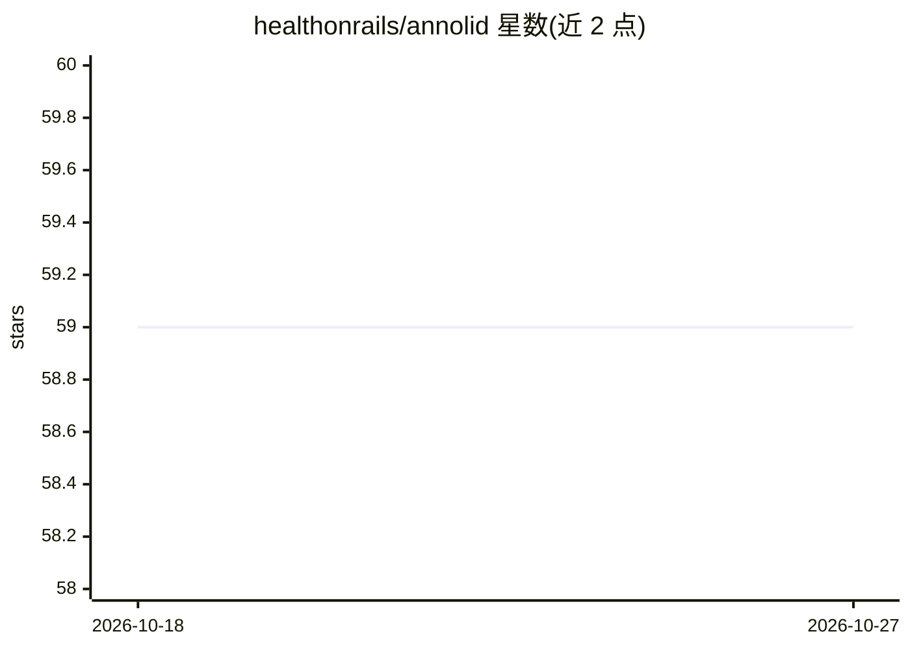

# healthonrails/annolid

⭐ 59 · Python · NOASSERTION · 推送 2026-10-02 · [GitHub](https://github.com/healthonrails/annolid) · 组织维护

**科研动物视频的标注、分割、多目标追踪与行为分析桌面工具**

面向动物行为研究的桌面应用加命令行工具：图像/视频标注（多边形、框、关键点、区域，保存 LabelMe 兼容格式）、基于实例分割的多动物追踪、稀疏身体部位关键点传播（DINOv3、TAPNext ONNX、CoWTracker）、行为事件打分与时间预算/区域指标导出。支持用一个标注种子帧初始化传播，模型经插件由 annolid-run 训练/预测/评估。GUI 内含 Annolid Bot 多模态助手，可接 MCP 外部工具。需 Python 3.10+，提供一键安装脚本，许可证为 CC BY-NC 4.0（禁商用）。

## 筛选速览

| 维度 | 判定 | 备注 |
|---|---|---|
| AI 角色 | `ai-native` | 本体是模型或模型工具 |
| 许可风险 | `none` | NOASSERTION |
| 部署形态 | `library` | 以包/库形式分发 |
| 模型依赖 | — | README 未给出锁定关系 |
| 硬件要求 | — | 无带数字的原话,不猜 |
| 安装摩擦 | `medium` | 含编译或系统依赖之一 |
| 成熟度 | — | 结构信号不足 |

## 能力要点

- 一个标注种子帧即可初始化多动物分割追踪
- 关键点传播支持 DINOv3 / TAPNext ONNX / CoWTracker 工作流
- annolid-run 模型插件化的训练/预测/评估，带 YAML 配置模板
- 行为事件 Timeline/Flags 打分并导出时间预算、bout 计数与区域指标

## 适用场景

- 给小鼠等实验动物视频做标注并追踪多个体身份
- 追踪鼻尖、尾根等身体部位关键点
- 打分并统计挖掘、直立等行为事件的时间预算
- 训练/评估自己的实例分割模型用于行为学分析

## 场景标签

`科研工具` `目标检测` `图像视频处理` · 领域:学习与行业

## 证据(README 行号)

> L9: > Annotate, segment, track, and analyze animals in research videos.
> L11: Annolid brings image and video annotation, instance segmentation, multi-animal tracking, keypoint tracking, and beh
> L26: |Track multiple animals|Use labeled seed frames with segmentation and tracking models, then review masks and identi

## 星数曲线

2026-10-18 59 → 2026-10-27 59（+0）

---
*卡片 v1 · prompt 1.4 · 生成 2026-10-24 · 置信度 high · 依据 README sha `6a5c9a68f4c8` · [字段定义](../../DATASET.md)*
