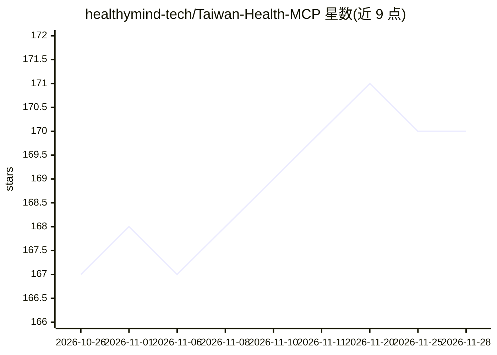

# healthymind-tech/Taiwan-Health-MCP

⭐ 170 · TypeScript · MIT · 推送 2026-11-18 · [GitHub](https://github.com/healthymind-tech/Taiwan-Health-MCP) · [官网](https://tw-health-mcp.healthymind-tech.com) · 组织维护 · 中文 README

**让 AI agent 读取台湾医疗数据的 MCP 服务器**

基于官方 TypeScript MCP SDK 构建的 Node.js 服务器，通过 MCP streamable-http 与 OpenAPI bridge 两种接口对外提供 73 个工具，分属 12 个群组：FHIR R4/TW Core IG 验证与资源编写、ICD-10/SNOMED CT/LOINC/RxNorm 查码与映射、TFDA 药品与食品营养查询、11 个确定性临床计算器。语义搜索用 pgvector 嵌入，嵌入不可用时退回关键词搜索；除 FHIR 服务器注册工具外全部只读。通过 docker compose 部署，附管理后台用于导入数据与配置。

## 筛选速览

| 维度 | 判定 | 备注 |
|---|---|---|
| AI 角色 | `ai-ecosystem` | LLM/agent 周边工具 |
| 许可风险 | `permissive` | MIT |
| 部署形态 | `self-host` | docker 或自建部署 |
| 模型依赖 | local-ok | 支持本地模型 |
| 硬件要求 | — | 无带数字的原话,不猜 |
| 安装摩擦 | `low` | 无编译、无系统依赖或容器化 |
| 成熟度 | — | 结构信号不足 |

## 能力要点

- 73 个 MCP 工具覆盖 FHIR 验证、医学术语、药品与临床计算
- 临床计算器为确定性计算，不交由 LLM 自行运算
- 除 FHIR 服务器注册外所有工具为只读
- 同时提供 MCP 与 OpenAPI 两种客户端接入接口

## 适用场景

- 让 Claude/Cursor 等 agent 查询 ICD-10、LOINC、SNOMED CT 编码并做跨语汇映射
- 对 TW Core IG 剖面验证与生成 FHIR R4 资源
- 查询 TFDA 药品许可与按外观辨识药丸
- 在院内部署后让 agent 读取已登记的 FHIR 服务器资源

## 场景标签

 · 领域:医疗健康/AI 工具基础设施

## 证据(README 行号)

> L7:  台灣醫療健康資料整合 MCP 伺服器
> L23: 以官方 **TypeScript MCP SDK**（`@modelcontextprotocol/sdk`）建構的 Node.js 伺服器，對外提供 **73 個工具**，涵蓋 12 個工具群組。專為高吞吐量的生產級 SaaS 
> L40: 其他支援 MCP streamable-http 的客戶端，填入同一個網址即可。要在自己的環境部署，請看自行部署。

## 星数曲线

2026-10-26 167 → 2026-11-28 170（+3）

---
*卡片 v1 · prompt 1.4 · 生成 2026-11-26 · 置信度 high · 依据 README sha `e2c297881365` · [字段定义](../../DATASET.md)*
