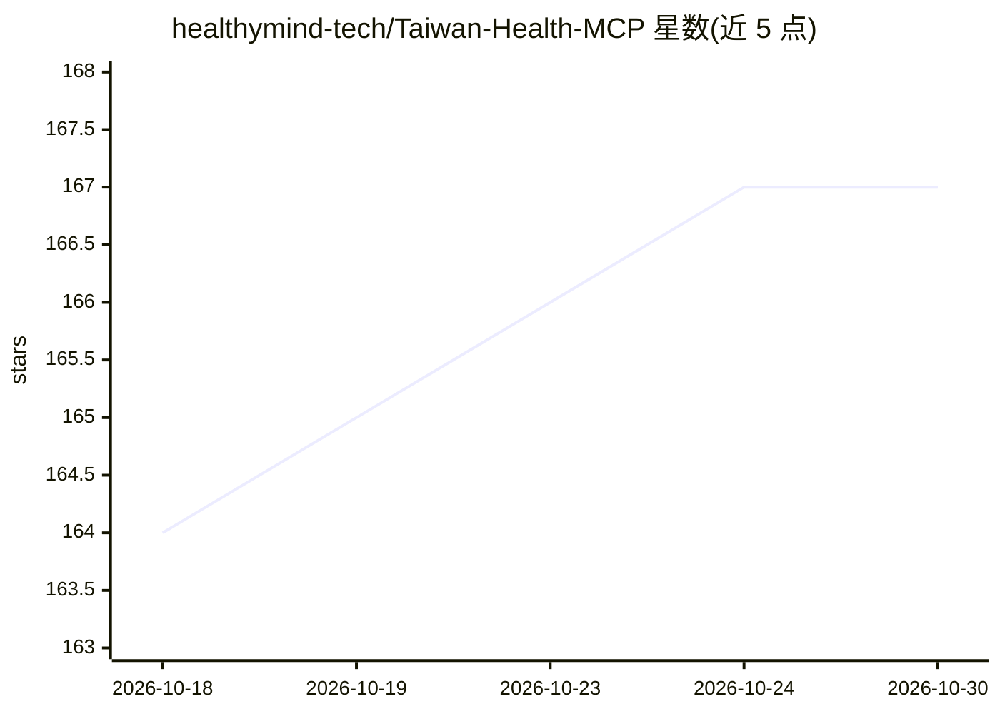

# healthymind-tech/Taiwan-Health-MCP

⭐ 167 · TypeScript · MIT · 推送 2026-10-26 · [GitHub](https://github.com/healthymind-tech/Taiwan-Health-MCP) · [官网](https://tw-health-mcp.healthymind-tech.com) · 组织维护 · 中文 README

**面向 AI agent 的台湾医疗数据 MCP 服务器（64 个工具）**

以官方 TypeScript MCP SDK 构建的 Node.js 服务器，为 AI agent 提供 64 个工具、12 个群组：FHIR R4 / TW Core IG 验证与骨架填值、ICD-10-CM/PCS 与 SNOMED CT、LOINC、RxNorm 术语查询、TFDA 药品查询与药丸识别、临床计算器（确定性计算，不让 LLM 自算）、pgvector 语义搜索（默认 Ollama 嵌入，无嵌入时退回关键字）。除 crud_fhir_server 外工具均为只读。提供官方托管端点，也可 Docker Compose 自部署，数据经管理后台导入。面向生产级 SaaS 部署设计。

## 筛选速览

| 维度 | 判定 | 备注 |
|---|---|---|
| AI 角色 | `ai-ecosystem` | LLM/agent 周边工具 |
| 许可风险 | `permissive` | MIT |
| 部署形态 | `self-host` | docker 或自建部署 |
| 模型依赖 | local-ok | 支持本地模型 |
| 硬件要求 | — | 无带数字的原话,不猜 |
| 安装摩擦 | `low` | 无编译、无系统依赖或容器化 |
| 成熟度 | — | 结构信号不足 |

## 能力要点

- 64 个 MCP 工具：FHIR 验证、术语查询、临床计算器、TFDA 药品识别
- TW Core IG 验证对齐 HL7 validator_cli 7.0.1，含不靠 LLM 的病历忠实度检查
- pgvector 语义搜索默认 Ollama qwen3-embedding，无嵌入时自动退回关键字
- 提供官方托管端点与 Docker Compose 自部署两种方式

## 适用场景

- 让 Claude/Cursor 等 agent 查询台湾药品许可证与药品识别
- 为医疗 agent 提供 ICD-10/SNOMED CT/LOINC 编码查询与检验值解读
- 对 FHIR 资源做 TW Core IG 验证与 grounding 检查
- 用确定性临床计算器（CHA₂DS₂-VASc、eGFR 等）替代 LLM 口算

## 场景标签

 · 领域:医疗信息化/AI agent 工具服务

## 证据(README 行号)

> L23: 以官方 **TypeScript MCP SDK**（`@modelcontextprotocol/sdk`）建構的 Node.js 伺服器，對外提供 **64 個工具**，涵蓋 12 個工具群組。專為高吞吐量的生產級 SaaS 
> L8:  整合 ICD-10-CM/PCS、SNOMED CT、LOINC、台灣 FDA 藥品 / 健康補充品 / 食品營養，以及 FHIR R4 IG 授權與驗證工具

## 星数曲线

2026-10-18 164 → 2026-10-30 167（+3）

---
*卡片 v1 · prompt 1.4 · 生成 2026-10-23 · 置信度 mid · 依据 README sha `b10cbc9ae92f` · [字段定义](../../DATASET.md)*
