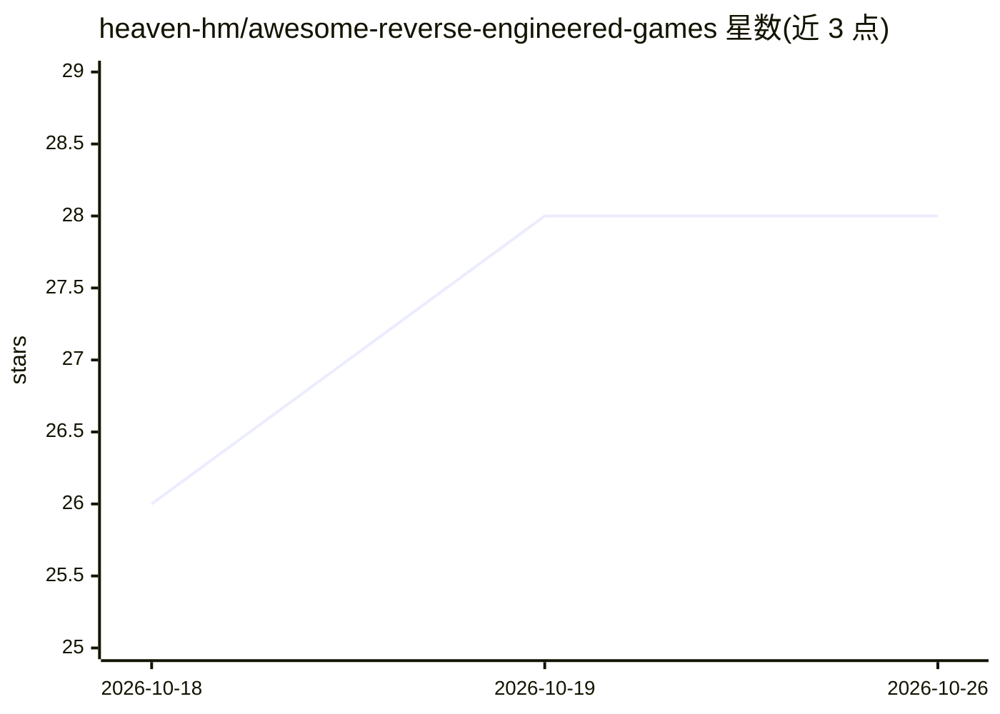

# heaven-hm/awesome-reverse-engineered-games

⭐ 28 · CC0-1.0 · 推送 2026-10-12 · [GitHub](https://github.com/heaven-hm/awesome-reverse-engineered-games) · 个人维护

**AI 辅助逆向/重制游戏的策展清单与指南**

由个人维护的 awesome 清单，收录 8 个借助 AI 模型与 agentic 工具（Claude Code、OpenAI Codex 等）完成逆向工程、反编译或重制的游戏案例，如 OpenIGI、SkyRoads、Tomba! 等，并附概览矩阵、逐项案例档案、工具列表（Ghidra/IDA Pro/Radare2 等）与 14 篇文档化指南，涵盖 MCP 集成、反编译工作流与文件格式重建方法论。面向游戏保存与逆向工程研究者的知识聚合仓库，许可证 CC0-1.0，不提供可安装软件本体。

## 筛选速览

| 维度 | 判定 | 备注 |
|---|---|---|
| AI 角色 | `ai-knowledge` | 知识聚合/清单类 |
| 许可风险 | `viral` | CC0-1.0 |
| 部署形态 | `desktop` | 安装包/桌面程序 |
| 模型依赖 | — | README 未给出锁定关系 |
| 硬件要求 | — | 无带数字的原话,不猜 |
| 安装摩擦 | `low` | 无编译、无系统依赖或容器化 |
| 成熟度 | — | 结构信号不足 |

## 能力要点

- 收录 8 个 AI 辅助游戏逆向/重制案例及概览矩阵
- 覆盖 Ghidra/IDA Pro/Radare2 的 MCP 集成与 AI 反编译工作流文档
- 附逆向工具清单与 14 篇方法论文档（静态/动态分析、文件格式重建等）

## 适用场景

- 查找 AI 辅助游戏逆向与重制的案例研究
- 学习将 LLM 与 Ghidra/IDA 等 MCP 工具结合的逆向工作流
- 了解老游戏保存与现代重制的技术路径

## 场景标签

`精选清单` · 领域:学习与行业

## 证据(README 行号)

> L9: A curated list and comprehensive guide of **awesome reverse-engineered, decompiled, and rebuilt games** powered by A
> L15: Modern game reverse engineering combines classical binary analysis (static disassembly, dynamic debugging, memory h
> L93: - AI Reverse Engineering Guide - Introduction to reverse engineering workflows assisted by large language models.

## 星数曲线

2026-10-18 26 → 2026-10-26 28（+2）

---
*卡片 v1 · prompt 1.4 · 生成 2026-10-26 · 置信度 high · 依据 README sha `fec12733d6b1` · [字段定义](../../DATASET.md)*
