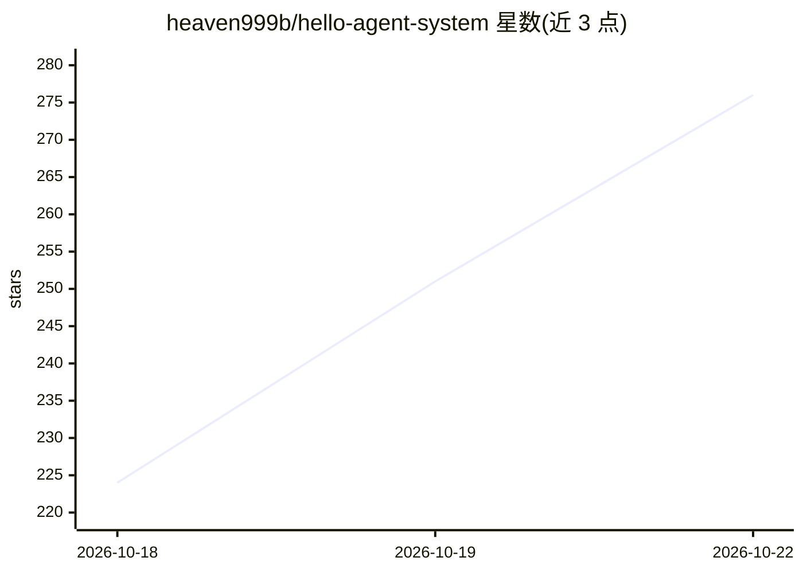

# heaven999b/hello-agent-system

⭐ 276 · Python · MIT · 推送 2026-09-28 · [GitHub](https://github.com/heaven999b/hello-agent-system) · 个人维护 · 中文 README

**中英双语企业级 Agent 系统设计课程，含可运行的 agentkit 运行时**

面向开发者的 32 节中英双语训练营，不依赖 Agent 框架，从零手写企业级 Agent 的工具、上下文、架构、可靠性、安全、评估、并发与分布式执行等各层，每课配带自动化测试的离线练习（ScriptedLLM 无需 API key）。附 agentkit 教学运行时（async 单进程、SQLite 多进程 worker、Postgres/Redis/Temporal/LiteLLM 等适配器）与 ITBuddy 综合实战。支持任何 OpenAI 兼容接口；agentkit 是参考实现，Docker/K8s 配置未实际启动过。

## 筛选速览

| 维度 | 判定 | 备注 |
|---|---|---|
| AI 角色 | `ai-knowledge` | 知识聚合/清单类 |
| 许可风险 | `permissive` | MIT |
| 部署形态 | `None` |  |
| 模型依赖 | — | README 未给出锁定关系 |
| 硬件要求 | — | 无带数字的原话,不猜 |
| 安装摩擦 | `low` | 无编译、无系统依赖或容器化 |
| 成熟度 | — | 结构信号不足 |

## 能力要点

- 32 节课覆盖工具/可靠性/安全/评估/分布式/成本/RAG/发布运维
- 每课练习带离线确定性自动化测试，零成本可学完
- agentkit 运行时：async 核心 + 多进程租约/fencing 队列 + 成熟组件适配器
- 附失败模式图鉴（79 种）、设计评审清单（199 条）、框架对照表

## 适用场景

- 系统学习从 LLM API 到生产级 Agent 系统的完整工程链路
- 想理解主流 Agent 框架背后原理后快速上手框架
- 面试或上线前用评审清单与失败模式图鉴自查

## 场景标签

`教程课程` · 领域:学习与行业

## 证据(README 行号)

> L5: **从"会调 LLM API"到"能设计生产级 Agent 系统"：32 节课 · 中英双语 · 每课都有带测试的练习。**
> L140: 每节课的流程都一样：**读讲义 → 跑 demo → 写练习 → `make lesson N=xx` 让测试变绿 → 过自测清单**。每课开头都标注了一篇 📖 必读论文或文章。

## 星数曲线

2026-10-18 224 → 2026-10-22 276（+52）

---
*卡片 v1 · prompt 1.4 · 生成 2026-10-22 · 置信度 high · 依据 README sha `ee233d112ad0` · [字段定义](../../DATASET.md)*
