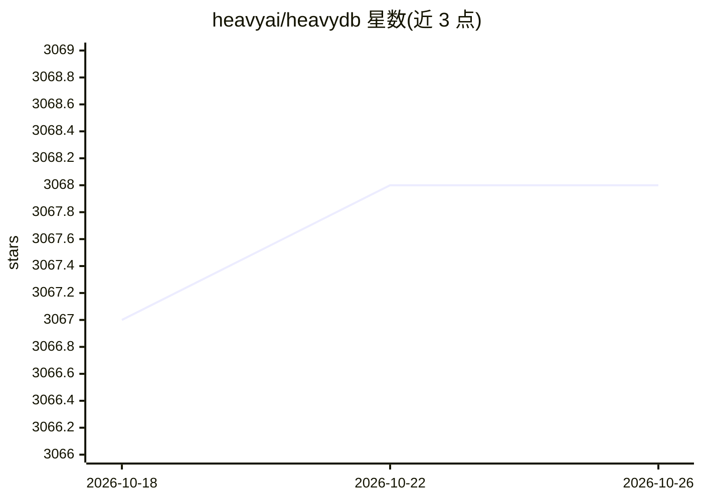

# heavyai/heavydb

⭐ 3,068 · C++ · Apache-2.0 · 推送 2026-10-23 · [GitHub](https://github.com/heavyai/heavydb) · [官网](https://heavy.ai) · 组织维护

**面向 GPU 的内存列式 SQL 数据库及 HeavyAI 分析平台**

原名 MapD Core / OmniSciDB 的内存列式 SQL 关系型数据库，从设计之初面向 GPU 运行。2026 年 10 月起仓库开放整个 HeavyAI 平台功能：Immerse 可视化界面、GPU 加速后端 Renderer（基于 Vega）、面向无线网络规划的 HeavyRF 传播仿真、通过外表接入外部数据（CSV/Parquet/日志/ODBC/Amazon S3）的 HeavyConnect。开发依赖脚本支持 Ubuntu 22.04 与 Rocky Linux 8.x，GPU 构建需要 NVIDIA 驱动与 CUDA toolkit，从源码构建生成可用的 docker 镜像。

## 筛选速览

| 维度 | 判定 | 备注 |
|---|---|---|
| AI 角色 | `ai-ecosystem` | LLM/agent 周边工具 |
| 许可风险 | `permissive` | Apache-2.0 |
| 部署形态 | `None` |  |
| 模型依赖 | — | README 未给出锁定关系 |
| 硬件要求 | — | 无带数字的原话,不猜 |
| 安装摩擦 | `medium` | 含编译或系统依赖之一 |
| 成熟度 | — | 结构信号不足 |

## 能力要点

- 内存列式 SQL 数据库，原生面向 GPU 运行
- Immerse 可视化界面与基于 Vega 的 GPU 加速 Renderer
- HeavyRF：结合地理空间数据的 RF 传播 GPU 仿真
- HeavyConnect 外表接入 CSV/Parquet/日志/ODBC/Amazon S3

## 适用场景

- 在 GPU 上运行大规模实时 OLAP 分析
- 构建地理空间数据的可视化仪表板
- 无线网络规划中的 RF 传播仿真
- 通过外表直接分析 S3 或本地文件数据

## 场景标签

`数据分析` · 领域:效率与自动化

## 证据(README 行号)

> L6: HeavyDB is an in-memory, column store, SQL relational database designed from the ground up to run on GPUs.
> L8: This repository has long been a limited open source version of the core HeavyDB, but as of October 2026, this projec

## 星数曲线

2026-10-18 3,067 → 2026-10-26 3,068（+1）

---
*卡片 v1 · prompt 1.4 · 生成 2026-10-20 · 置信度 mid · 依据 README sha `f888fb25fdbc` · [字段定义](../../DATASET.md)*
