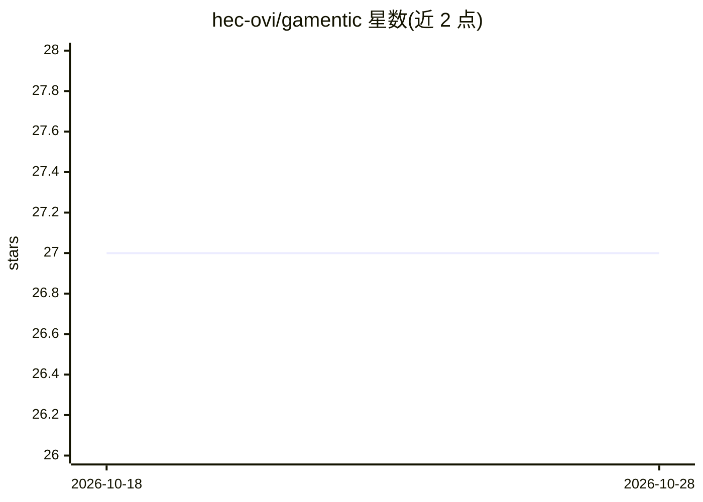

# hec-ovi/gamentic

⭐ 27 · Python · MIT · 推送 2026-07-25 · [GitHub](https://github.com/hec-ovi/gamentic) · [官网](https://hec-ovi.github.io/gamentic/) · 组织维护

**自托管本地 AI 地下城 RPG：浏览器游玩，全本地生成文本/图像/语音**

基于浏览器游玩的自托管 AI 地下城 RPG，在本地机器上运行：一个本地 LLM 通过各自专属上下文分别扮演叙事者与多个角色 agent（各有 persona、记忆与声音），角色行动须经校验工具写入 SQLite 才能改变游戏状态；图像由 FLUX.2 klein/ComfyUI 本地生成，语音由 Maya1-3B TTS 合成。技术栈为 FastAPI+SQLite+原生 JS，通过 docker-compose 部署，为 AMD Strix Halo APU 调优，支持更换任意 GGUF 模型或 OpenAI 兼容端点，文本模式即可完整游玩。

## 筛选速览

| 维度 | 判定 | 备注 |
|---|---|---|
| AI 角色 | `ai-native` | 本体是模型或模型工具 |
| 许可风险 | `permissive` | MIT |
| 部署形态 | `None` |  |
| 模型依赖 | local-ok | 支持本地模型 |
| 硬件要求 | — | 无带数字的原话,不猜 |
| 安装摩擦 | `low` | 无编译、无系统依赖或容器化 |
| 成熟度 | — | 结构信号不足 |

## 能力要点

- 单一本地 LLM 分饰叙事者与多个角色 agent，各带独立记忆与人格
- 角色行动须经校验工具写入数据库，模型幻觉不能直接改写游戏状态
- 本地生成场景图、角色立绘、物品卡（FLUX.2 klein/ComfyUI）与角色语音（Maya1 TTS）
- 各模态提供者可配置替换，支持 OpenAI 兼容端点接入

## 适用场景

- 在自己机器上离线玩 AI 驱动的分支剧情地下城 RPG
- 与各有记忆、性格与秘密的 AI 角色对话和互动
- 把冒险导出为模板或检查点分享给他人游玩

## 场景标签

 · 领域:游戏/AI 娱乐

## 证据(README 行号)

> L3: A self-hosted AI dungeon RPG you play in the browser. An AI narrator and a cast of AI characters, each with its own 
> L24: - Explore scenes, search for hidden things, find ways out. Talk to characters: each one is its own agent with its o

## 星数曲线

2026-10-18 27 → 2026-10-28 27（+0）

---
*卡片 v1 · prompt 1.4 · 生成 2026-10-26 · 置信度 high · 依据 README sha `70f8c7dacf5f` · [字段定义](../../DATASET.md)*
